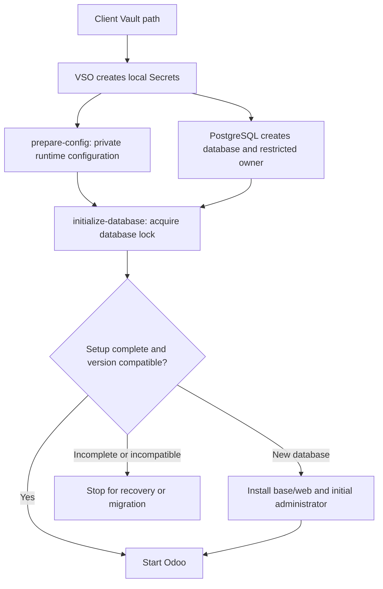

# Design

## Architecture

The deployment uses one Helm chart and a separate release namespace per client.
Odoo 20 runs behind a shared Traefik controller. Each client owns its PostgreSQL 16
instance and two separate Longhorn volumes: RWX for Odoo, RWO for PostgreSQL.

```text
                             Browser
                                |
                              HTTPS
                                v
                       Shared Traefik ingress
                                |
      +-------------------------v--------------------------+
      |              Client namespace (A / B / C)          |
      |                                                    |
      |            Odoo Service :8069 / :8072              |
      |                         |                          |
      |                         v                          |
      |  HPA ----------> Odoo replicas (1-4)               |
      |   ^                     |            |             |
      |   |                     v            v             |
      | CPU metrics       Shared RWX     PostgreSQL :5432  |
      |                   PVC: 10 GiB        |             |
      |                   sessions +         v             |
      |                   attachments    RWO PVC: 20 GiB   |
      |                         |            |             |
      +-------------------------|------------|-------------+
                                |            |
                                v            v
                       Longhorn persistent storage
                    (separate volumes for every client)
```

The chart can alternatively run a dedicated Traefik proxy per client. Exactly one
proxy mode is enabled. Shared ingress is the default for the three client profiles.
Odoo and PostgreSQL Services remain internal; Odoo connects to its database using
`odoo-db.<client-namespace>.svc.cluster.local:5432`.

| Consumer | PVC | Container location | Storage |
| --- | --- | --- | --- |
| Odoo replicas | `odoo-odoo-data` | `/var/lib/odoo` | Longhorn RWX, 10 GiB |
| PostgreSQL | `odoo-db-data` | `/var/lib/postgresql/data/pgdata` | Longhorn RWO, 20 GiB |

RWX lets Odoo replicas share files across nodes. PostgreSQL writes its database and
WAL to its own RWO volume; it does not share Odoo's volume. Longhorn replicates volume
blocks according to its configuration, but this does not add PostgreSQL standby
instances or replace backups.

## Main decisions

| Decision | Reason |
| --- | --- |
| One chart, separate client values | Consistent deployment without copying templates |
| Namespace and PostgreSQL per client | Separate credentials, storage, capacity and lifecycle |
| Shared ingress | Avoid a proxy/load balancer for every client by default |
| Longhorn RWX application volume | All Odoo replicas need the same sessions and attachments |
| CPU-based HPA | Automatically adjust application capacity to load |
| Vault with VSO | Keep secret values out of Git and Helm values |
| Init container | Initialize the database before Odoo accepts requests |

## Initialization and security



Both init containers run when a pod is created. Configuration is rebuilt for that
pod; database setup runs only when needed. Concurrent initializers wait on a
PostgreSQL advisory lock. Administrator setup and its completion marker commit
together, so restarts preserve existing users and passwords. Demo data is disabled.

The application database role has no superuser, role-management or database-creation
privileges. Database listing stays disabled. Workloads run as non-root with restricted
capabilities and no service-account token. The main Odoo container does not mount the
initial web-login credentials or the PostgreSQL administrator password.

NetworkPolicies allow the configured proxy to reach Odoo, and Odoo to reach only its
client's database and DNS. Proxy access matches its namespace and pod labels together.
SMTP and external integrations need explicit egress rules. Kubernetes RBAC, Secret
encryption at rest and CNI policy enforcement remain cluster responsibilities.

## Automatic scaling

Each client has an HPA with a default range of 1–4 Odoo replicas and a target of 70%
average CPU utilization. It adds at most one pod per minute. Scale-down stabilizes
for five minutes and removes at most one pod per minute. Metrics Server supplies
usage; the Deployment leaves replica count under HPA control.

All replicas use the same database, image and RWX data directory. Odoo's standard
cron workers coordinate jobs through PostgreSQL row locks. Custom jobs must handle
retries and external side effects appropriately.

The chart rejects multiple replicas with RWO application storage and checks this
conservative connection budget at the maximum replica count:

```text
maxReplicas × ((workers + cronWorkers + 1) × dbMaxconn + dbMaxconnGevent)
  + connectionReserve <= PostgreSQL maxConnections
```

With client defaults, four replicas budget 80 application connections plus 20 reserved
connections against a database limit of 100. Quotas allow that replica range. Higher
limits require reviewing database resources, node capacity and storage performance.
CPU autoscaling does not detect every database or I/O bottleneck.

## Persistence and operational limits

Fresh installs create new volumes; no migration is needed. Existing RWO application
data would require copying to a new RWX claim selected through `odoo.storage.existingClaim`.
Both chart-managed PVCs are retained on Helm uninstall, but namespace deletion or
storage loss can still remove data. Retention and Longhorn replication are not backups.

This implementation prioritizes scaling over full HA. PostgreSQL and the optional
dedicated proxy remain single instances. `Recreate` application rollouts interrupt
service; no node-placement or database-failover guarantee is configured.

Major Odoo upgrades require a compatible database migration and addons. The initializer
blocks a database from a different Odoo major series. Application/module changes need
backup and maintenance planning; Helm rollback cannot reverse database changes.
Database password changes must be coordinated between SQL and Vault.

Logs go to container stdout/stderr. Probes check process health and database-server
reachability, not business workflows; operational checks must also cover attachments,
scheduled jobs and backup freshness.

## Validation and next steps

| Validation | Status |
| --- | --- |
| Helm rendering and configuration checks for all clients | Verified locally |
| Fresh initialization, login, attachments, HTTPS and WebSockets | Verified in local containers |
| Concurrent initialization and sessions/attachments across two replicas | Verified with a local shared volume |
| HPA reactions, Longhorn RWX, VSO and shared ingress on k3s | Requires cluster verification |

Use [the verification guide](docs/verification.md) for cluster checks. Before production,
add coordinated database/filestore backups, restore drills, monitoring and alerts.
Backups should capture both data stores as one recovery set and be stored outside the
cluster. Restore into separate resources and verify records and attachments.

For larger fleets, keep client-specific values, upgrade in small batches and measure
capacity. GitOps and independently managed HA PostgreSQL clusters can be added later
without sharing PostgreSQL between clients.
