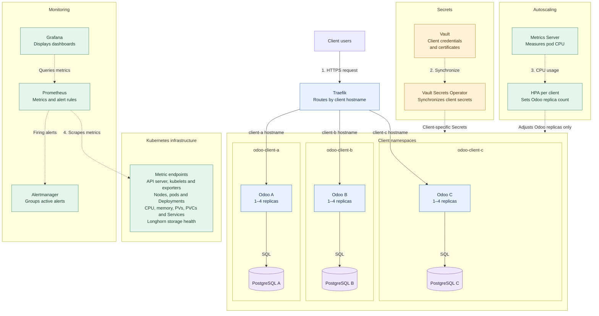
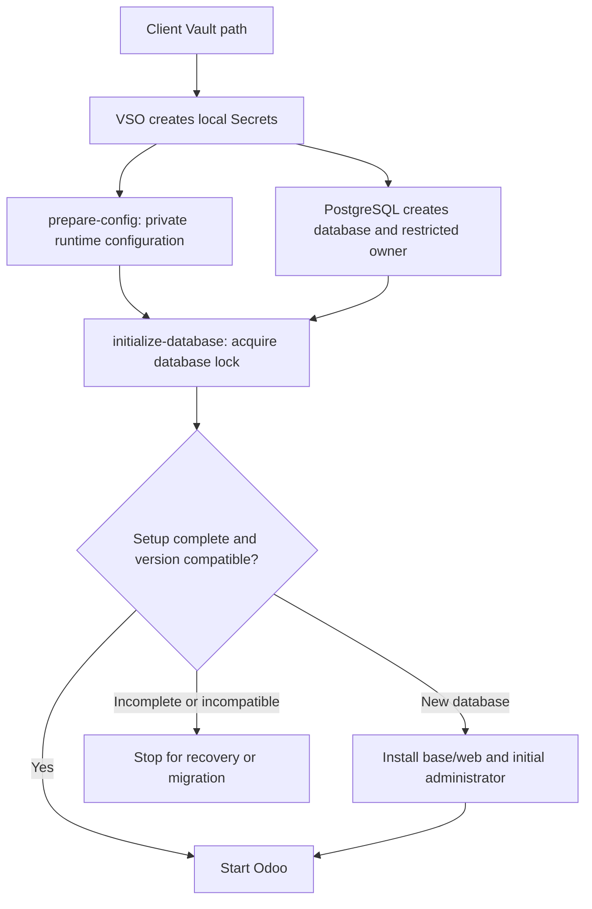
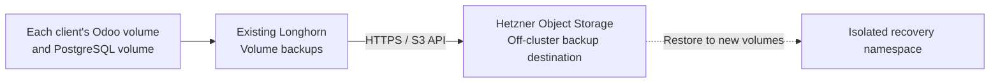

# Design

## Architecture

The deployment uses one Helm chart and a separate release namespace per client.
Odoo 20 runs behind a shared Traefik controller. Each client owns its PostgreSQL 16
instance and two separate Longhorn volumes: RWX for Odoo, RWO for PostgreSQL.



Solid arrows show application traffic. Dashed arrows show
secret synchronization, scaling decisions and monitoring interactions. Their labels
identify the action and direction. Everything except client users runs inside k3s; the boxes separate responsibilities, not cluster nodes.

| Flow | How to read it |
| --- | --- |
| 1. Client traffic | Traefik selects the client's Odoo by hostname. Odoo connects only to that client's PostgreSQL. |
| 2. Secrets | VSO reads the client's permitted Vault path and creates Secrets in that client's namespace. |
| 3. Scaling | Metrics Server supplies CPU usage. Each HPA adjusts its Odoo replicas between 1 and 4; PostgreSQL stays at one replica. |
| 4. Monitoring | Prometheus scrapes cluster-wide resource usage, workload state, PV/PVC and Service metadata, and Longhorn health. Grafana queries Prometheus; Alertmanager groups alerts. External notifications need configuration. |

Each client uses separate Longhorn volumes for Odoo and PostgreSQL. Vault,
Prometheus, Grafana and Alertmanager have their own Longhorn RWO volumes.
VSO is installed separately. Monitoring pod resources does not yet expose Vault
seal status or PostgreSQL internal health.

The chart can alternatively run a dedicated Traefik proxy per client. Exactly one
proxy mode is enabled. Shared ingress is the default for the three client profiles.
Odoo and PostgreSQL Services remain internal; Odoo connects to its database using
`odoo-db.<client-namespace>.svc.cluster.local:5432`.

| Consumer | PVC | Container location | Storage |
| --- | --- | --- | --- |
| Odoo replicas | `odoo-odoo-data` | `/var/lib/odoo` | Longhorn RWX, 10 GiB |
| PostgreSQL | `odoo-db-data` | `/var/lib/postgresql/data/pgdata` | Longhorn RWO, 20 GiB |

RWX lets Odoo replicas share files across nodes. PostgreSQL writes its database and
WAL to its own RWO volume; it does not share Odoo's volume. Longhorn replicates volume
blocks according to its configuration, but this does not add PostgreSQL standby
instances or replace backups.

## Main decisions

| Decision | Reason |
| --- | --- |
| One chart, separate client values | Consistent deployment without copying templates |
| Namespace and PostgreSQL per client | Separate credentials, storage, capacity and lifecycle |
| Shared ingress | Avoid a proxy/load balancer for every client by default |
| Longhorn RWX application volume | All Odoo replicas need the same sessions and attachments |
| CPU-based HPA | Automatically adjust application capacity to load |
| Vault with VSO | Keep secret values out of Git and Helm values |
| Shared Prometheus and Grafana | View cluster and client health in one place |
| Longhorn backups to Hetzner Object Storage | Keep volume backups outside the Kubernetes cluster |
| Init container | Initialize the database before Odoo accepts requests |

## Initialization and security



Both init containers run when a pod is created. Configuration is rebuilt for that
pod; database setup runs only when needed. Concurrent initializers wait on a
PostgreSQL advisory lock. Administrator setup and its completion marker commit
together, so restarts preserve existing users and passwords. Demo data is disabled.

The application database role has no superuser, role-management or database-creation
privileges. Database listing stays disabled. Workloads run as non-root with restricted
capabilities and no service-account token. The main Odoo container does not mount the
initial web-login credentials or the PostgreSQL administrator password.

NetworkPolicies allow the configured proxy to reach Odoo, and Odoo to reach only its
client's database and DNS. Proxy access matches its namespace and pod labels together.
SMTP and external integrations need explicit egress rules. Kubernetes RBAC, Secret
encryption at rest and CNI policy enforcement remain cluster responsibilities.

## Automatic scaling

Each client has an HPA with a default range of 1–4 Odoo replicas and a target of 70%
average CPU utilization. It adds at most one pod per minute. Scale-down stabilizes
for five minutes and removes at most one pod per minute. Metrics Server supplies
usage; the Deployment leaves replica count under HPA control.

All replicas use the same database, image and RWX data directory. Odoo's standard
cron workers coordinate jobs through PostgreSQL row locks. Custom jobs must handle
retries and external side effects appropriately.

The chart rejects multiple replicas with RWO application storage and checks this
conservative connection budget at the maximum replica count:

```text
maxReplicas × ((workers + cronWorkers + 1) × dbMaxconn + dbMaxconnGevent)
  + connectionReserve <= PostgreSQL maxConnections
```

With client defaults, four replicas budget 80 application connections plus 20 reserved
connections against a database limit of 100. Quotas allow that replica range. Higher
limits require reviewing database resources, node capacity and storage performance.
CPU autoscaling does not detect every database or I/O bottleneck.

## Persistence and operational limits

Fresh installs create new volumes; no migration is needed. Existing RWO application
data would require copying to a new RWX claim selected through `odoo.storage.existingClaim`.
Both chart-managed PVCs are retained on Helm uninstall, but namespace deletion or
storage loss can still remove data. Retention and Longhorn replication are not backups.

This implementation prioritizes scaling over full HA. PostgreSQL and the optional
dedicated proxy remain single instances. `Recreate` application rollouts interrupt
service; no node-placement or database-failover guarantee is configured.

Major Odoo upgrades require a compatible database migration and addons. The initializer
blocks a database from a different Odoo major series. Application/module changes need
backup and maintenance planning; Helm rollback cannot reverse database changes.
Database password changes must be coordinated between SQL and Vault.

Logs go to container stdout/stderr. Probes check process health and database-server
reachability, not business workflows; operational checks must also cover attachments,
scheduled jobs and backup freshness.

## Monitoring

One [Prometheus installation](docs/prometheus.md) and
[Grafana instance](docs/grafana.md) in namespace
`monitoring` observes all clients and infrastructure. Prometheus collects node,
kubelet, Kubernetes object and Longhorn metrics; Grafana shows CPU/memory, nodes,
pods, Deployment replicas, PV/PVC state and Service metadata. Service inventory
does not prove application reachability. Alertmanager groups the supplied alerts;
external notification receivers require configuration.

Prometheus, Grafana and Alertmanager run as plain Kubernetes StatefulSets, each
with a separate Longhorn RWO volume. ConfigMaps provision scraping, alert rules,
the Grafana data source and a namespace-filtered overview dashboard. A Deployment
collects Kubernetes object state; a DaemonSet exports metrics from each node.
This initial setup uses one replica per component and internal Services with local
port-forward access. It does not replace Metrics Server for HPA or collect logs.
Application-specific database and Vault health metrics are separate future additions.

## Backups and recovery

Longhorn already provides storage. Its backup target and recurring jobs will be
configured manually to use a private Hetzner Cloud Object Storage bucket. No backup
manifests, schedules or credentials are managed by this repository.



Set the bucket's location-specific endpoint, S3 credentials, schedule, retained
backup count and selected volumes in Longhorn. Hetzner endpoints include
`fsn1.your-objectstorage.com`, `nbg1.your-objectstorage.com` and
`hel1.your-objectstorage.com`; use the endpoint matching the bucket's location.
See [Hetzner's S3 setup](https://docs.hetzner.com/storage/object-storage/getting-started/using-s3-api-tools/)
and [Longhorn backup targets](https://longhorn.io/docs/1.13.0/snapshots-and-backups/backup-and-restore/set-backup-target/).

| Data | Recovery requirement |
| --- | --- |
| Each client's Odoo and PostgreSQL volumes | Select both; record their volume identities and matching recovery point |
| Grafana, Prometheus and Alertmanager volumes | Select separately if their saved state/history must be retained |
| Vault and recovery credentials | Maintain a supported Vault snapshot/recovery procedure and keep unseal material and storage credentials outside the cluster |

Longhorn snapshots are taken per volume. Recurring jobs do not automatically pause
Odoo or coordinate its filestore with PostgreSQL. For a matched recovery set, stop
all client Odoo writers with its HPA suspended, wait for transactions to finish,
then take both snapshots before allowing writes again. PostgreSQL data and WAL
must remain together on the database volume. Live volume recovery can require
PostgreSQL crash recovery; volume backups do not provide database point-in-time recovery.

After setup, confirm successful remote backups and restore a coordinated pair to
new volumes in an isolated namespace. Use the matching PostgreSQL major version
and Odoo image/addons; check database startup, login, records and attachment
downloads before reopening traffic. Keep the original volumes until recovery is
verified. A volume backup does not replace Kubernetes manifests, TLS certificates,
Vault recovery material or access to the object-storage bucket.

## Validation and next steps

| Validation | Status |
| --- | --- |
| Helm rendering and configuration checks for all clients | Verified locally |
| Fresh initialization, login, attachments, HTTPS and WebSockets | Verified in local containers |
| Concurrent initialization and sessions/attachments across two replicas | Verified with a local shared volume |
| HPA reactions, Longhorn RWX, VSO and shared ingress on k3s | Requires cluster verification |
| Standalone monitoring manifests, configuration and dashboard | Local configuration checks; metric collection requires cluster verification |
| Longhorn backups to Hetzner Object Storage and restore drill | Planned; manual Longhorn setup and recovery verification required |

Use [the verification guide](docs/verification.md) for cluster checks. Before production,
configure the Longhorn backup plan above, verify coordinated restores and add external alert delivery.
Backups should capture both data stores as one recovery set and be stored outside the
cluster. Restore into separate resources and verify records and attachments.

For larger fleets, keep client-specific values, upgrade in small batches and measure
capacity. GitOps and independently managed HA PostgreSQL clusters can be added later
without sharing PostgreSQL between clients.
