# Design

## Scope and current state

This chart deploys one customer installation into a dedicated namespace: an autoscaled Odoo Deployment, one dedicated PostgreSQL pod, separate persistent volumes, either an optional dedicated Traefik proxy or routes through a shared ingress controller, and VSO resources that synchronize secrets from the existing Vault in `vault-namespace`. Three client configurations reuse the chart; PostgreSQL is never shared between clients.

The current milestone is a readable, locally renderable chart. Deployment, Vault authentication/synchronization, database initialization, storage permissions, restore behavior and application functionality remain unverified on the target cluster. This is not yet a claim of production readiness.

The deployment path is a fresh installation: there are no existing application PVCs
or customer databases to migrate. New application claims use Longhorn RWX, while
PostgreSQL claims remain RWO. Existing-volume/version migration notes describe a
future import or upgrade scenario, not a prerequisite for the first installation.
The [verification runbook](docs/verification.md) defines the target-cluster checks
and their pass criteria; documenting them does not mean they have been executed.

Local verification with Odoo 20.0-20261102 and PostgreSQL 16 confirmed fresh
initialization, disabled demo data, restricted database-role privileges, authenticated
web access, attachment upload/download and persistence after restart. HTTP/database
health checks and WebSocket protocol upgrades passed both directly and through the
rendered dedicated Traefik configuration, including HTTPS and HTTP-to-HTTPS redirect
(using a temporary local certificate). Rerunning initialization preserved existing
credentials even after the initial credential inputs changed. A real Odoo 19 database
was rejected without modification by the major-version guard. Temporary Docker
volumes were configured to match the chart's UID/GID and writable group permissions.
All client configurations are checked locally; VSO, NetworkPolicy enforcement, shared
ingress reconciliation and the target Kubernetes storage remain unverified.

The scaling change was additionally verified with two Odoo replicas and concurrent
initializers sharing a local data volume: cross-replica sessions, attachments and
WebSocket access passed. All three clients render valid HPA/storage configurations
in both proxy modes, and unsafe replica/storage/connection-budget combinations are
rejected. Metrics-based scaling and Longhorn RWX remain target-cluster checks.

The three client configurations use shared ingress:

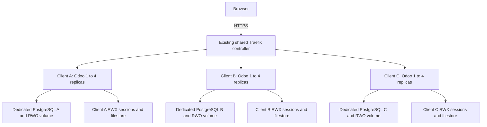

The shared controller is managed outside this chart. Each client is installed with
Helm release `odoo` in its own namespace. The [README](README.md#install-a-client-with-helm)
documents the exact install, database initialization and upgrade commands.

Optional standalone dedicated-proxy mode:

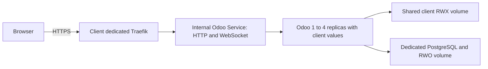

## Chart components

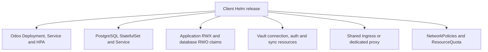

| Component | Helm/Kubernetes implementation |
| --- | --- |
| Odoo service | `templates/odoo/deployment.yaml` and `service.yaml` |
| PostgreSQL service | `templates/postgresql/statefulset.yaml` and headless Service |
| Persistent storage | Two retained PVCs |
| Mounted application configuration | ConfigMap plus private runtime config volume |
| Environment credentials | VSO-created local Secrets referenced by the pods |
| Health checks and restart policy | Startup/readiness/liveness probes and workload controllers |
| Reverse proxy and certificates | Shared-controller Ingress and TLS Secret, or dedicated Traefik Deployment/Service |

In standalone mode the chart runs Traefik with its file provider. That mode needs no Kubernetes API credentials, IngressClass, Ingress resource or Traefik CRDs. Fleet mode instead creates standard Ingress resources for an existing controller; the controller and IngressClass are platform prerequisites. Certificate issuance is external in both modes. No custom application image, chart dependencies or shared pod-template framework is introduced. Clients are installed and upgraded directly with Helm using common and client-specific values files.

Templates are grouped under `odoo/`, `postgresql/`, `traefik/`, `ingress/` and `vault/`. Shared render-time checks live in `common/validate.yaml`: Helm evaluates them to reject incompatible values, but the file emits no Kubernetes resource. Optional namespace quotas live in `common/resourcequota.yaml`. Config checksum references point to the service folders.

## Vault Secrets Operator

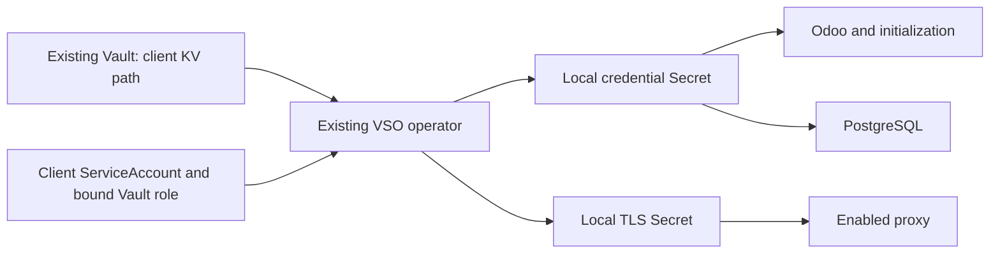

Vault already exists in Kubernetes namespace `vault-namespace`. This chart creates a local `VaultConnection`, `VaultAuth`, authentication ServiceAccount, and `VaultStaticSecret` resources. It installs neither Vault nor VSO. The operator and its CRDs must already exist and watch the application namespace.

The standalone chart defaults to role `vault-role` and KV v2 mount/path `ODOO/CLIENT-A`. The three client files override these with roles `odoo-client-a`, `odoo-client-b`, `odoo-client-c` and paths `CLIENT-A`, `CLIENT-B`, `CLIENT-C` under mount `ODOO`. Each role must be bound to ServiceAccount `odoo-vault-auth` in its exact client namespace and read only its own path. The configured address is `https://vault.vault-namespace.svc.cluster.local:8200`, built from the service, namespace and cluster-domain values. Service name `vault`, Kubernetes auth mount `kubernetes`, audience `vault`, and KV engine version are assumptions to confirm. A private Vault CA must be supplied in a separate local trust Secret; TLS verification stays enabled. `vault.auth.namespace` is an optional Vault Enterprise namespace and is distinct from the Kubernetes namespace.

VSO authenticates using a short-lived token for `<release>-vault-auth` in the application namespace. The existing Vault role must bind that exact ServiceAccount/namespace and grant read access to the configured KV path. No Vault token is stored in chart values or mounted into application pods. Workload service-account token automounting remains disabled.

The [VSO secret resources](https://developer.hashicorp.com/vault/docs/deploy/kubernetes/vso/sources/vault) reconcile Vault data into Kubernetes Secrets. One sync selects `admin-password`, `db-password`, `postgres-password`, `odoo-admin-login` and `odoo-admin-password` into `existingSecret`; another selects `tls.crt` and `tls.key` into `sharedIngress.tlsSecret` or `traefik.tlsSecret`, according to the enabled proxy mode. TLS synchronization is created immediately when either proxy mode is enabled; Odoo has no ready endpoint until initialization finishes. Raw Vault payloads and unrelated fields are excluded. Destination Secrets are created locally, with overwrite of unmanaged existing Secrets disabled. Secret values remain in Vault and the destination Kubernetes Secrets, so Kubernetes RBAC and encryption at rest still matter.

VSO polls every minute and restarts Odoo after credential changes. TLS changes restart only the dedicated Traefik Deployment; the shared controller watches TLS Secrets without a chart-triggered restart. VSO deliberately does not restart PostgreSQL: a restart cannot change passwords stored in SQL. Coordinate database password updates and KV updates in a maintenance window; details are in [the Vault runbook](docs/vault.md). TLS data synchronization distributes an existing certificate; issuance and renewal still happen outside this chart.

Only the operator contacts Vault. The existing application NetworkPolicies continue to permit Traefik → Odoo → PostgreSQL and DNS, without application-to-Vault access. The operator's own namespace policies must allow Vault/API/DNS access; Vault's namespace policies must admit the operator. Those existing infrastructure policies are not modified here. Pods can wait for initial Secret synchronization; Helm rendering does not verify Vault connectivity or the first sync.

## Required services

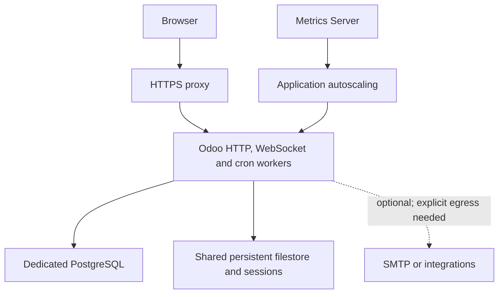

PostgreSQL is the only required separate application service in this baseline; `psql` is a database client, not another server. The [official Odoo image](https://hub.docker.com/_/odoo) contains the HTTP, WebSocket and scheduled-job processes. Redis and a separate queue service are not required. Persistent filestore storage remains necessary alongside the database.

Traefik provides HTTPS and reverse proxying. SMTP is optional for email. Monitoring and backup systems are operational dependencies to add later. Any new dependency requires its own internal address and an explicit network rule.

## Dedicated Traefik and internal FQDN routing

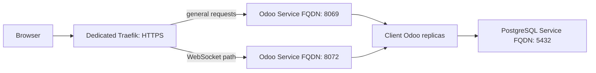

`templates/traefik/configmap.yaml` contains the listeners and routes. The [Traefik file provider](https://doc.traefik.io/traefik/reference/install-configuration/providers/others/file/) lets us specify the upstream URLs directly and keep the configuration local to this release.

In dedicated-proxy mode, every inter-service upstream is an internal FQDN built from the release, namespace and configurable `clusterDomain`:

- Traefik HTTP: `http://<release>-odoo.<namespace>.svc.<clusterDomain>:8069`.
- Traefik WebSockets: `http://<release>-odoo.<namespace>.svc.<clusterDomain>:8072`.
- Odoo database: `<release>-db.<namespace>.svc.<clusterDomain>:5432`, in both `odoo.conf` and the official entrypoint's `HOST` variable.

Traefik gives `/websocket` higher routing priority than the general application route. It listens on unprivileged container ports 8000/8443, exposed as 80/443 by its Service. HTTP redirects explicitly to external port 443. TLS uses a VSO-synchronized mounted certificate Secret, with TLS 1.2 as the minimum. The dashboard and API are not enabled; the separate ping port is only for pod probes. VSO restarts Traefik when certificate data changes. `tlsRevision` remains a manual restart option if VSO is disabled.

Odoo remains ClusterIP-only; PostgreSQL remains headless/internal. Only Traefik may use a LoadBalancer Service. Set its Service to ClusterIP if the browser-facing endpoint must also remain internal. No application upstream uses public DNS or a hard-coded pod IP.

In dedicated-proxy mode, NetworkPolicies restrict Traefik egress to this release's Odoo pods and cluster DNS; Odoo egress to its PostgreSQL pod and DNS; and PostgreSQL ingress to Odoo. PostgreSQL initiates no outbound connections. Odoo accepts application traffic only from this release's Traefik pods. These rules use same-namespace pod selectors and release labels, so other releases are not automatically trusted. Shared ingress uses the controller namespace and pod labels instead, as described below. Node probes and authorized administrative port-forwarding are separate control-plane paths.

DNS names provide service discovery; NetworkPolicies enforce the permitted destinations and ports. Standard Kubernetes NetworkPolicy cannot prove that a caller used a hostname instead of its resolved IP. Confirm CNI enforcement and DNS selectors, especially if the cluster uses NodeLocal DNS. Additional policies are additive, so review existing namespace policies as well.

## Application configuration

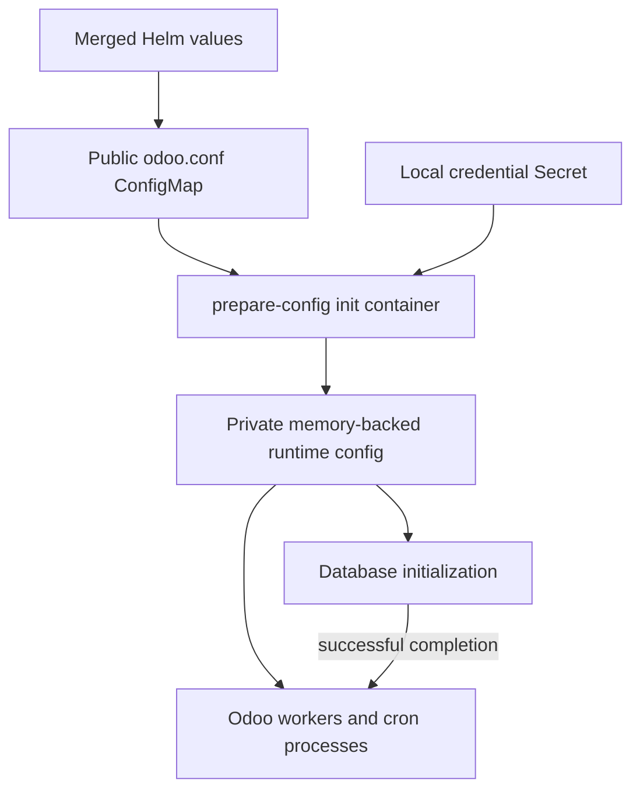

The chart uses Odoo 20 and PostgreSQL 16. Odoo configuration stays visible in `templates/odoo/configmap.yaml`; it includes the database filter, worker limits, proxy mode and logging. Odoo 20 defaults to a loopback HTTP listener, so the chart explicitly sets
`http_interface = 0.0.0.0` for Kubernetes probes and proxy traffic on both 8069 and
8072. Each pod defaults to two HTTP workers and one cron worker with a 4 GiB pod limit. Memory limits in Odoo apply per worker, so they must be budgeted against the whole pod. PostgreSQL settings are starting estimates, not benchmark results.

The [official Odoo entrypoint](https://github.com/odoo/docker/blob/master/20.0/entrypoint.sh) supports `PASSWORD_FILE` and waits for PostgreSQL. We keep that entrypoint. The prepare-config init container copies the public configuration and appends the master and database passwords from a Secret to a memory-backed volume. Initialization and the main container mount that private file read-only, so the official entrypoint reads the database password from configuration. The initialize-database init container uses chart-managed Python logic and Odoo CLI commands from the same image. Initial web credentials are mounted only in that init container; pod access remains privileged access.

No custom addons are mounted yet. Future addons should be delivered in a versioned image derived from the official image, so code changes are reproducible.

## Security and initial setup

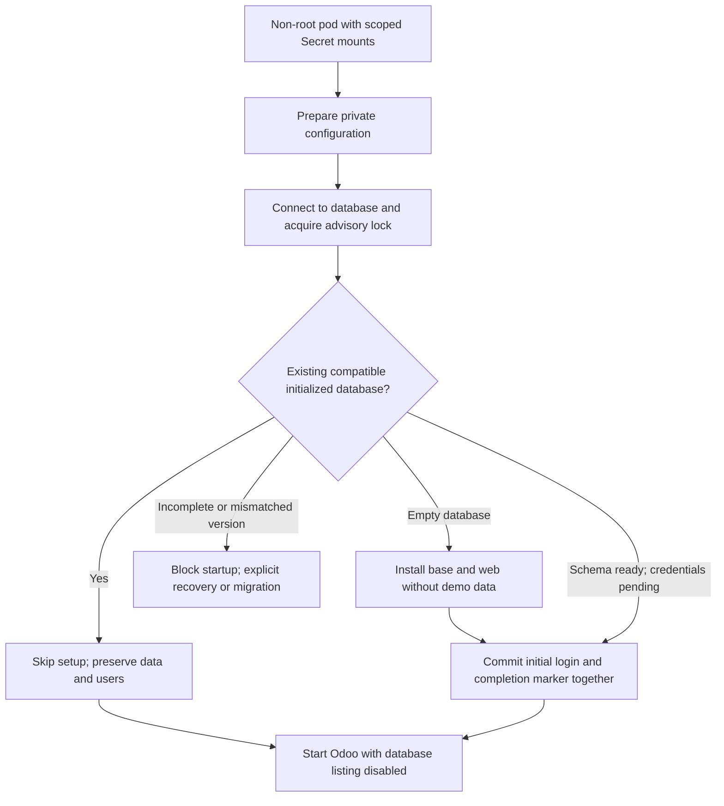

The chart-managed Odoo, PostgreSQL and optional dedicated Traefik workloads run as non-root with a read-only root filesystem, dropped capabilities and no service-account token. Writable data, configuration, temporary files and PostgreSQL sockets have explicit volumes. Odoo uses UID/GID 1000 with volume group permissions; PostgreSQL uses the Debian image's UID/GID 999; dedicated Traefik uses UID/GID 65532. The target storage driver must support these permissions. The external shared controller has its own security configuration and needs Kubernetes API access to watch routing resources and Secrets.

PostgreSQL uses a separate administrator password. On an empty data volume its initialization SQL creates the client database and an owner role with NOCREATEDB, NOSUPERUSER and NOCREATEROLE. The application never receives the PostgreSQL administrator password. Existing volumes do not rerun that SQL; an administrator must ensure the configured database/role exist and revoke any legacy CREATEDB privilege before upgrading.

Odoo starts with its normal database restriction, database listing disabled and proxy
mode enabled. After private configuration preparation, initialize-database waits for
the configured database, obtains a session advisory lock and checks its schema. An
empty database receives base and web without demo data. Initial web credentials come
from the separate Vault keys odoo-admin-login and odoo-admin-password. Odoo starts
serving only after the init container exits successfully.

A database-local odoo_deployment_init table records pending/complete setup. The initial
administrator update and completion marker commit in one transaction. If module
initialization finished but credential finalization was interrupted, a retry can
finish credentials before the main container starts. A partial module installation
blocks startup for manual recovery; no database is dropped or automatically reset.
An initialized existing database without the marker is accepted without changing
users, passwords or modules. A completed marker causes future init runs to skip all
initial setup. Initial web credentials must remain available as Secret keys for the
pod volume, but later Vault changes do not rotate existing Odoo web passwords.

The init container never performs module upgrades. Before accepting an existing
database, it compares the installed base module series with the running image. A
major-version mismatch blocks startup without changing data. An existing Odoo 19
database must be migrated and validated with compatible addons before using Odoo 20;
a Helm image change cannot migrate the schema. Restoring or changing an Odoo version
requires the explicit migration procedure. The initialization wait budget
covers database connectivity; Helm's timeout must also allow module installation.

Public TLS terminates at Traefik. Internal HTTP and PostgreSQL connections stay inside the cluster and are network-restricted, but are not encrypted in this baseline. Add internal TLS if required by the deployment's threat model. Kubernetes Secrets also require suitable RBAC and encryption at rest. External APIs, SMTP and internet access are denied by default.

## Persistence, availability and upgrades

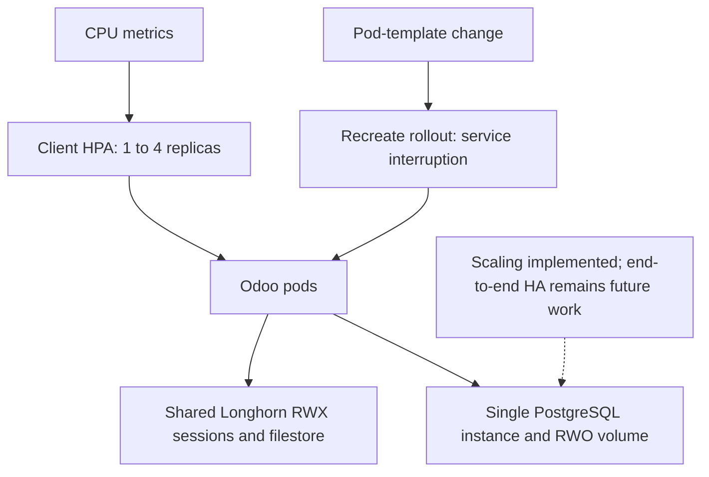

Each client's Odoo Deployment has a CPU-based autoscaling/v2 HPA enabled by the
common client values, with minReplicas=1, maxReplicas=4 and a 70% CPU utilization
target. HPA owns the replica count; the Deployment omits spec.replicas when enabled.
The standalone chart defaults to autoscaling disabled and one fixed replica.
Scale-up adds at most one pod per minute; scale-down stabilizes for 300 seconds and
removes at most one pod per minute. Metrics Server and sufficient k3s capacity are
required; CPU metrics do not detect every database/storage bottleneck.

The client values use StorageClass longhorn and ReadWriteMany for the shared Odoo
data volume. It holds both filestore and sessions, allowing requests to move between
replicas. The same application image and database are used by every replica. Concurrent
initializers wait for the existing PostgreSQL advisory lock, then check completion.
A bounded wait prevents an initializer from waiting indefinitely. Odoo cron row locks
coordinate standard jobs across processes; custom side effects still need idempotency.

The chart rejects multi-replica configurations with RWO storage, and checks a
conservative connection-pool budget at the maximum HPA size:
maxReplicas × ((workers + maxCronThreads + 1) × dbMaxconn + dbMaxconnGevent)
+ postgresql.connectionReserve <= postgresql.maxConnections.
The extra pool accounts for the master process. Client pool sizes are 4, resulting
in a budget of 80 application connections plus 20 reserved at four replicas. These
are capacity bounds, not measured concurrency. Namespace quotas accommodate four
application replicas, PostgreSQL and the optional proxy; larger configurations need
resource, database and quota review together.

Existing RWO PVCs cannot be patched into RWX volumes. Copy the complete Odoo data
into a new RWX claim during maintenance and select it via odoo.storage.existingClaim;
the chart then references that claim instead of creating an application PVC. It does
not migrate files or delete the old retained claim. PostgreSQL retains its own RWO
volume and PGDATA subdirectory, with its original storage settings.

That migration is conditional on an existing RWO application claim. It is not
performed or required for the three new client installations.

Recreate remains the deployment strategy, so application rollouts still interrupt
service even with autoscaling. Scaling a replica count does not itself trigger a
pod-template rollout. PostgreSQL and the optional dedicated proxy remain single
instances. There is no new failover, topology guarantee or end-to-end HA claim.

PVC retention protects against Helm uninstall, not namespace deletion, storage loss or operator mistakes. PostgreSQL belongs to each client's release. At fleet scale, an operator can provide a separately managed database lifecycle with replication and tested failover while retaining a dedicated PostgreSQL cluster for every client.

The image settings accept full digest references. Resolve and pin the enabled workloads' image digests before deployment; the current tags are human-readable starting versions. Test application/module upgrades against a restored database. A Helm rollback only restores Kubernetes configuration; schema rollback requires a compatible recovery plan. Dedicated Traefik is also single-replica. Shared-controller availability is configured separately; neither proxy mode makes Odoo or PostgreSQL highly available.

## Backup and recovery plan — not implemented yet

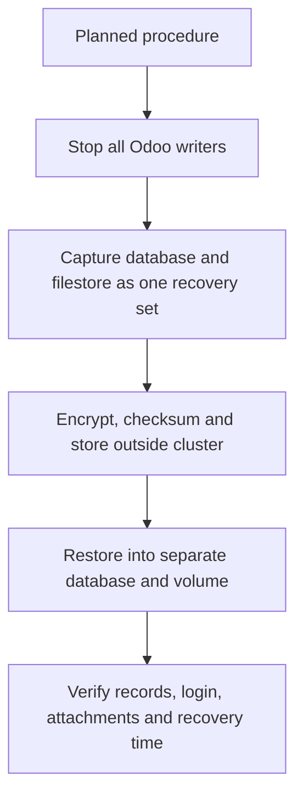

Treat the database and filestore as one recovery set. For the first implementation, stop all Odoo writers, take a PostgreSQL logical backup and filestore archive, record a shared backup identifier and image version, and resume service after both captures complete. Store encrypted copies outside the cluster with checksums and retention.

Restore into a separate database and volume, start the matching Odoo image, then verify login, representative records and attachment contents. Measure actual recovery time. Agree recovery-point and recovery-time targets before choosing the final schedule; scheduled backups and successful restore evidence are required before production acceptance.

## Observability and silent failures

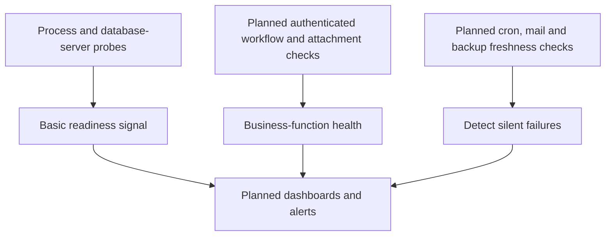

Logs go to container stdout/stderr for the cluster logging system. Dedicated Traefik emits JSON access logs without request headers; its ping probe checks proxy health, not end-to-end application behavior. Shared-controller logging and probes are configured outside the chart. Odoo liveness checks the HTTP process; readiness uses the [official health endpoint's database-server check](https://github.com/odoo/odoo/blob/20.0/addons/web/controllers/home.py). That check connects to the maintenance database and does **not** prove the customer database or business workflows are healthy.

Next, integrate alerts for unavailable pods, repeated restarts, latency/errors, database connections, disk capacity and backup age. Add an authenticated synthetic workflow that reads a record and retrieves an attachment, plus freshness checks for scheduled jobs and outgoing mail. Alert delivery and restore drills need independent verification. These integrations are planned, not resources currently installed by the chart.

## Three clients with a path to 100

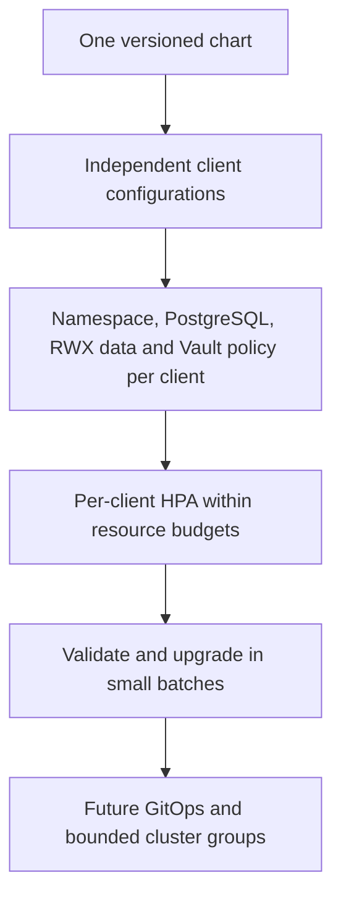

`clients/common.values.yaml` enables shared ingress, CPU autoscaling, Longhorn RWX
storage and a ResourceQuota. The client-a,
client-b and client-c directories supply separate databases, roles, hostnames and Vault
paths. Direct Helm commands install release `odoo` in namespace `odoo-<client>`,
applying common values before client values, an optional client traefik.values.yaml
and any local overrides. Each client owns its normal values and optional proxy
override; no temporary database setup values file is required. A normal Helm install
provisions the database and runs the Odoo init container. The [README](README.md#install-a-client-with-helm)
contains installation and upgrade commands; the [client guide](docs/clients.md)
explains capacity and configuration. There is no shared PostgreSQL server, and adding
a values directory does not deploy it automatically.

Fleet ingress uses Kubernetes Service references, while standalone Traefik uses
explicit FQDN upstream URLs. The Odoo NetworkPolicy selects the shared controller
by namespace AND pod labels in one peer, and still allows database egress only to
the same release's PostgreSQL in the same namespace. The main application starts only after initialization succeeds. VSO supplies each namespace's TLS Secret; only dedicated
Traefik gets a certificate-triggered rollout. Shared-controller HTTP redirects,
timeouts, replicas and availability are platform responsibilities.

ResourceQuota bounds each namespace's aggregate CPU, memory, storage and object
counts; it does not reserve hardware or provide complete tenant isolation. Client
administrators need appropriately scoped RBAC. Actual NetworkPolicy enforcement
and ingress behavior remain unverified until cluster testing.

Roll updates out to a small customer group before expanding. Distribute customers
across bounded Kubernetes clusters to limit incident impact as needed. Capacity
planning must include worker memory and database connections per customer. GitOps,
automated fleet onboarding, database migrations, backup jobs and monitoring remain future
work; adding directories does not provision those systems.

Automatic Odoo replica scaling is implemented with shared RWX data. Longhorn NFS
behavior under load, HPA reactions and node-failure recovery still require validation
on k3s. CPU autoscaling does not establish an Odoo HA architecture.

## Next milestones

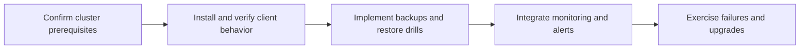

1. Confirm namespace, storage, cluster domain, DNS selectors, load-balancer support, Vault/VSO installation, auth binding and TLS trust.
2. Pin image digests and run Vault sync/rotation, initialization, login, HTTPS redirect, WebSocket, FQDN resolution, network-isolation and persistence checks once deployment is authorized.
3. Implement backup/restore automation and collect restore evidence.
4. Integrate monitoring, synthetic checks and alerts.
5. Exercise failure and upgrade scenarios, then prepare the interview presentation from verified results.
