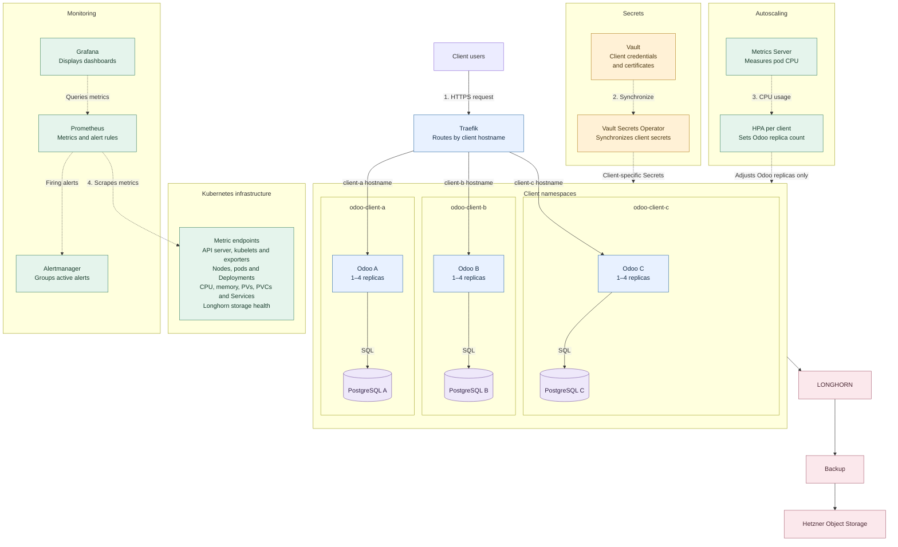
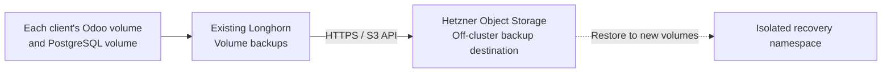

# System design and decisions

## Goals and assumptions

The design runs an independent Odoo environment for each client while keeping
provisioning and operations consistent as the fleet grows. Three client profiles
exercise the deployment pattern; supporting 100–500 clients requires capacity
planning and operational automation, not simply increasing the number of profiles.

I chose k3s and Helm because Kubernetes supplies scheduling, resource controls,
service discovery and autoscaling, while one chart keeps client deployments
consistent. This assumes an existing k3s cluster, Longhorn, Metrics Server and
Traefik. The official Odoo 20 image runs the application; PostgreSQL 16 stores
business data. Installation commands belong in [README](README.md) and the
[operational guides](docs/clients.md).

The scope prioritizes client isolation and application scaling. Production use
still requires cluster verification, manually configured backups, recovery drills
and alert delivery. The current deployment does not provide full application HA.

## Architecture

Each client owns a namespace, Odoo Deployment, PostgreSQL StatefulSet and two
persistent volumes. Shared services handle ingress, secret synchronization and
monitoring. The diagram includes the planned, manually configured backup path.



Solid arrows show application traffic, storage and the backup path. Dashed arrows
show secret synchronization, scaling decisions and monitoring interactions. Client
users and Hetzner Object Storage are outside k3s; the boxes group responsibilities,
not physical nodes. VSO is installed separately from the supplied Vault manifests.

## Main decisions and tradeoffs

| Choice | Why I chose it | Tradeoff |
| --- | --- | --- |
| One Helm chart, client-specific values | Reuse deployment logic and review client differences in small files | Chart changes need validation and staged rollout across clients |
| A namespace and PostgreSQL instance per client | Separate credentials, data, quotas and upgrade/recovery lifecycles | More database processes, connections and backups than a shared database server |
| Shared Traefik ingress | Route client hostnames without a proxy/load balancer per client | Shared infrastructure has a wider failure impact; a dedicated proxy remains optional |
| Longhorn RWX for Odoo | Replicas need the same attachment filestore and sessions | Depends on network storage and NFS client support; adds shared storage dependencies |
| Separate Longhorn RWO for PostgreSQL | Keep database files and WAL together, separate from application files | Storage replication does not create PostgreSQL standbys or database failover |
| CPU HPA for each client | Adjust Odoo capacity automatically using existing Kubernetes mechanisms | CPU does not reveal every database or storage bottleneck |
| Vault with VSO | Keep secret values outside Git/Helm and synchronize per-client Secrets | Requires Vault availability, unsealing, policies and operator lifecycle management |
| Database initialization in an init container | Make a fresh client usable without a separate bootstrap installation | Must safely handle retries, concurrent pods and incompatible databases |
| Prometheus and Grafana as StatefulSets | Keep shared services in explicit manifests with persistent state | Provisioning, updates, collectors, dashboards and alerts must be maintained directly |
| Longhorn backups to Hetzner Object Storage | Use existing storage tooling to keep recovery data outside the cluster | Volume backups need coordinated recovery points and tested restores |

## Security and client isolation

Namespaces separate Kubernetes resources, but they are not a complete security
boundary. NetworkPolicies restrict Odoo ingress to the configured proxy and egress
to its own database and DNS. Controller namespace and pod labels must match the
actual ingress installation. SMTP and other integrations need explicit egress rules.
Cluster RBAC, Secret encryption at rest and CNI enforcement remain infrastructure
responsibilities. Quotas limit client consumption rather than reserving node capacity.

Odoo runs as UID/GID 1000 and PostgreSQL as UID/GID 999, with restricted capabilities,
no privilege escalation and no mounted ServiceAccount token. The application role
cannot create databases or roles and has no superuser privileges. Odoo database
listing is disabled. These choices reduce the privileges available after an
application compromise, while clients still share the cluster's nodes and kernel.

VSO authenticates through a client-specific ServiceAccount bound to a Vault role
that can read only that client's KV path. It creates local credential and TLS
Secrets. The main Odoo container never mounts the PostgreSQL administrator password
or initial web-login credentials. Private CA verification stays enabled. Database
password rotation must update SQL and Vault together; changing a Secret alone does
not change a PostgreSQL password. See [Vault setup](docs/vault.md).

The shared services have different access needs: Vault requires TokenReview,
Prometheus requires node-proxy access, and node-exporter reads host metrics through
host mounts and namespaces. Their permissions must not be treated as equivalent to
those of the application pods. The three Vault instances also need protected
unseal material and controlled, one-at-a-time updates.

## Data persistence and initialization

| Data | Storage | Reason |
| --- | --- | --- |
| Odoo sessions and attachments | Per-client 10 GiB RWX PVC at `/var/lib/odoo` | All replicas must see the same files |
| PostgreSQL database and WAL | Per-client 20 GiB RWO PVC; PGDATA at `/var/lib/postgresql/data/pgdata` | Preserve the complete database independently of Odoo pod replacement |
| Vault, Prometheus, Grafana and Alertmanager | Separate Longhorn RWO volumes | Preserve shared-service state across pod replacement |

The client PVCs are retained on Helm uninstall, but namespace deletion or storage
loss can still destroy them. Longhorn block replication and local snapshots do not
replace external backups. Fresh installs need no volume migration; importing an
existing RWO Odoo volume requires copying its data to an RWX claim.

I chose initialization that is safe to repeat because every new pod runs its init
containers. The first prepares private configuration; the second waits for
PostgreSQL and acquires a database advisory lock. An empty database receives the
base/web modules and initial administrator without demo data. Concurrent replicas
wait rather than initializing the same database together.

A completion marker preserves existing users and passwords on later starts.
Incomplete initialization or an incompatible Odoo major version blocks startup
instead of resetting data. This makes failures visible and recoverable, but leaves
repair and major-version migration as explicit operator work.

## Scaling and reliability

Each client HPA controls 1–4 Odoo replicas at 70% average CPU utilization. It can add
one pod per minute; scale-down waits five minutes and removes at most one per minute.
Metrics Server supplies usage. Prometheus serves observability rather than the CPU
HPA. Helm omits the Deployment replica count when the HPA is enabled.

Replicas share the same database, image and RWX data directory. PostgreSQL row locks
coordinate standard Odoo cron jobs; custom jobs still need safe retries and external
side-effect handling. The chart rejects multiple replicas with RWO application
storage and bounds database connection demand:

```text
maxReplicas × ((workers + cronWorkers + 1) × dbMaxconn + dbMaxconnGevent)
  + connectionReserve <= PostgreSQL maxConnections
```

Four replicas budget 80 application connections plus 20 reserved against the default
limit of 100. Increasing the replica limit therefore requires reviewing pools,
database resources, quotas and node capacity together.

The main availability limits are deliberate and visible: PostgreSQL remains a
single instance, Odoo uses `Recreate` rollouts, and no application placement or
failover guarantee is configured. More replicas improve application capacity but
do not remove these failure points. Database HA and less disruptive rollouts would
be a separate next step with corresponding storage and operational changes.

At minimum replicas, 100 client profiles request 75 CPU cores, 125 GiB memory and
3,000 GiB logical storage before shared services, Longhorn replication and spare
capacity. This illustrates the cost of dedicated databases; it is not a measured
capacity claim. Larger fleets need automated onboarding, staged upgrades, backup
assignment and capacity monitoring. Cluster partitioning can limit the impact of
shared infrastructure failures as the fleet grows.

## Observability and silent failures

Prometheus collects Kubernetes object state through kube-state-metrics, resource
usage through kubelet/cAdvisor and node-exporter, and Longhorn storage metrics.
Grafana provides a namespace-filtered overview; Alertmanager groups firing alerts.
The shared stack runs once rather than once per client. Services remain internal
and are accessed through local port-forwards. See [Prometheus](docs/prometheus.md)
and [Grafana](docs/grafana.md) for installation and access.

I separate process health from successful business operations: a healthy HTTP
process does not prove that login, attachments, scheduled jobs or backups work.

| Failure | Existing signal | Remaining requirement |
| --- | --- | --- |
| Odoo stops responding or cannot reach its database | HTTP startup/liveness/readiness probes; pod readiness and restart alerts | Validate actual behavior on k3s |
| A pod runs but stays unready, or storage fills | Prometheus readiness, restart, PVC and scrape-target rules | Configure external notification receivers and response ownership |
| Login or attachment operations fail while health probes pass | Manual verification of login and file upload/download across replicas | Add a scheduled synthetic business-workflow check |
| Scheduled business jobs stop producing results | Container logs and basic workload/resource metrics | Monitor job completion/freshness, not just the Odoo process |
| Secret synchronization or Vault availability fails | VSO resource status/events, workload readiness and manual Vault checks | Add explicit sync-freshness and Vault seal/quorum alerts |
| Backups stop, become stale or cannot restore | Planned Longhorn backup status checks and restore drill | Configure backup freshness/failure alerts and repeat restore verification |

The current stack does not collect application logs or Kubernetes event history,
probe Service reachability, or expose PostgreSQL internals and Vault seal status.
Scrape-target alerts cannot detect an endpoint that disappears from discovery;
expected-target inventory and missing-data alerts would close that gap. CPU metrics
and Kubernetes Service metadata alone cannot establish business availability.

Prometheus, Grafana and Alertmanager each have one replica. Monitoring therefore
has its own restart/outage windows. Production operation needs alert delivery and
an independent way to detect a failure of the monitoring stack itself. SLO targets,
recovery objectives and escalation ownership should be agreed before onboarding
production clients; none have been measured or committed here.

## Backups and recovery

I chose the existing Longhorn backup mechanism with a private **Hetzner Cloud Object
Storage** bucket as the destination. This reuses the storage platform and keeps
recovery data outside the cluster. The target, credentials, recurring jobs, selected
volumes and retention will be configured manually in Longhorn; the repository does
not install or enable a backup policy.



Both the Odoo filestore and PostgreSQL volume must be included for every client.
Grafana/monitoring state can be selected separately. Vault needs a supported snapshot
and recovery procedure, with unseal material and object-storage credentials available
outside the cluster. Infrastructure manifests and certificates also need to remain
recoverable; a volume backup alone cannot rebuild the platform.

Per-volume snapshots are not an atomic application recovery point. For a coordinated
set, suspend the client's HPA, stop all Odoo writers, wait for transactions to finish,
and snapshot both volumes before writes resume. Handle detached volumes using
Longhorn's supported backup procedure, and verify both snapshots upload successfully.
PostgreSQL data and WAL stay together on one volume; a live restore may require crash
recovery. This design does not provide database point-in-time recovery.

The regional Hetzner endpoint must match the bucket location. Assign recurring jobs
to both client volumes in Longhorn. PVC labels are an alternative way to select an
existing job/group; labels alone do not create schedules. Setup references:
[Hetzner S3 access](https://docs.hetzner.com/storage/object-storage/getting-started/using-s3-api-tools/)
and [Longhorn backup targets](https://longhorn.io/docs/1.13.0/snapshots-and-backups/backup-and-restore/set-backup-target/).

A restore drill must recover a coordinated pair into new volumes in an isolated
namespace using the matching PostgreSQL major version and Odoo image/addons. Check
startup, login, business records and attachment downloads before reopening traffic.
Record the recoverable point and recovery time, and retain the original volumes
until the restored service is verified. A completed upload is not proof of recovery.
