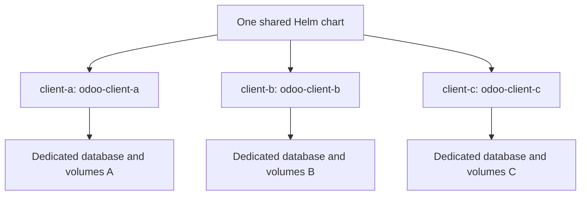
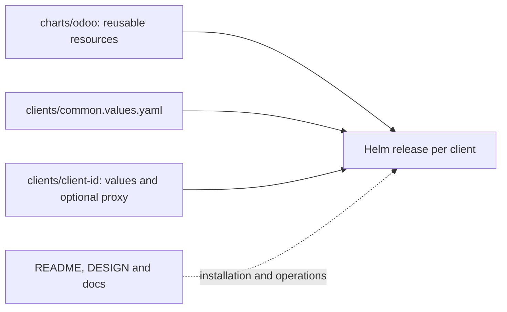
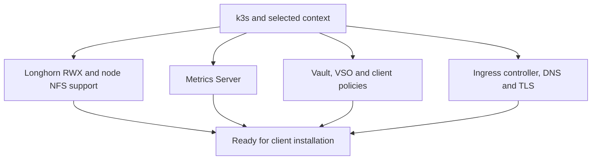
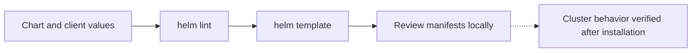
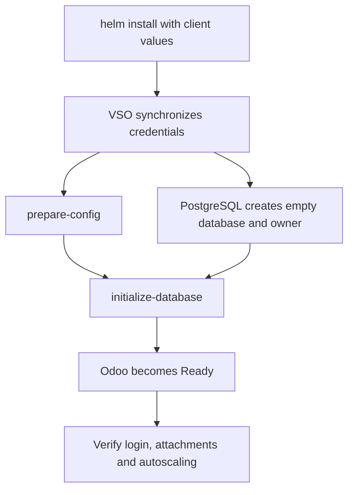
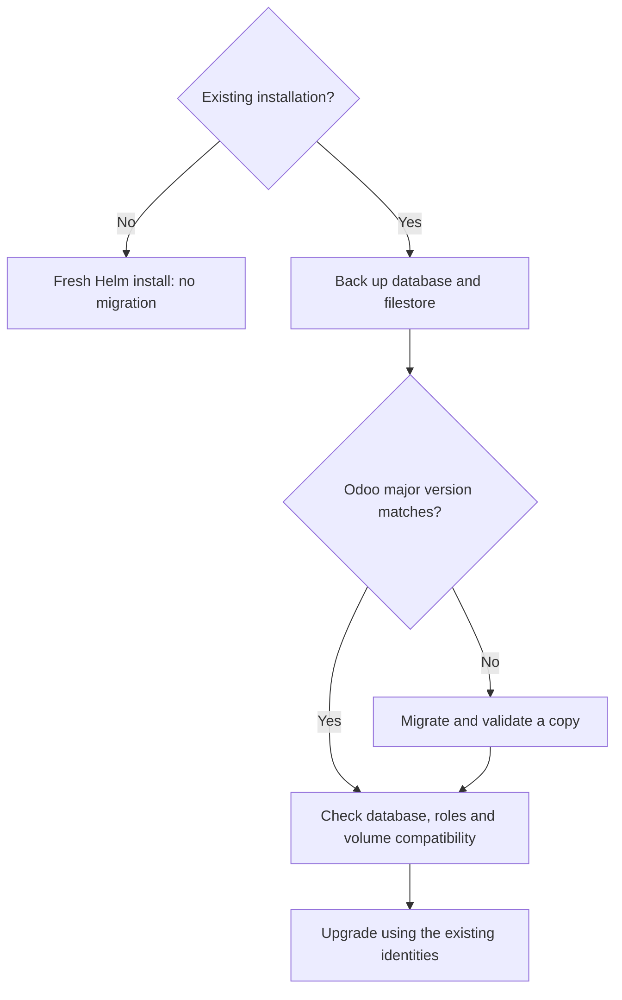
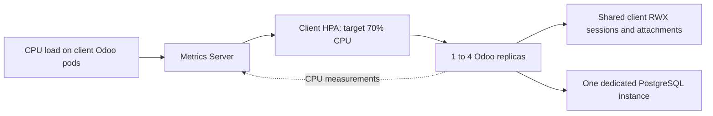
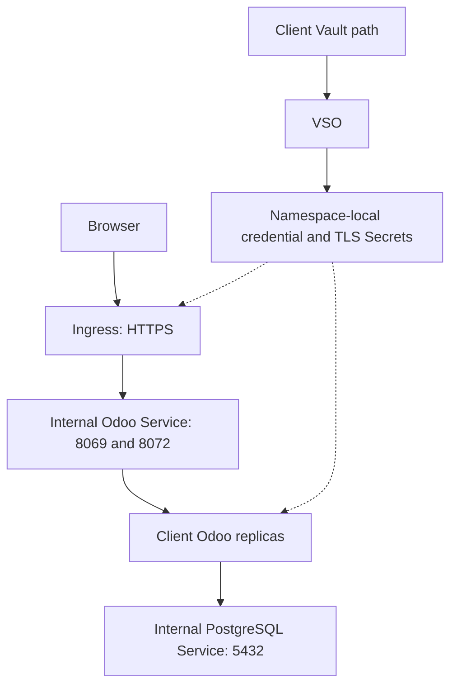
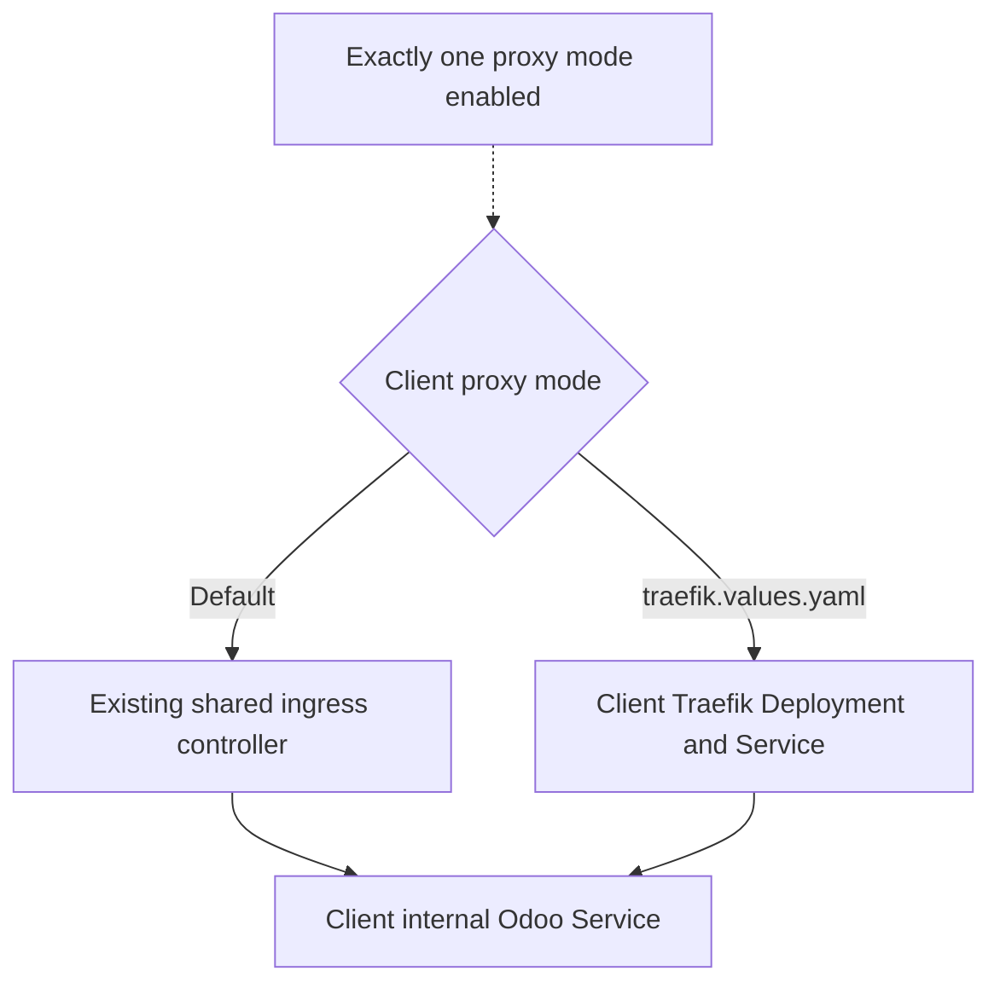
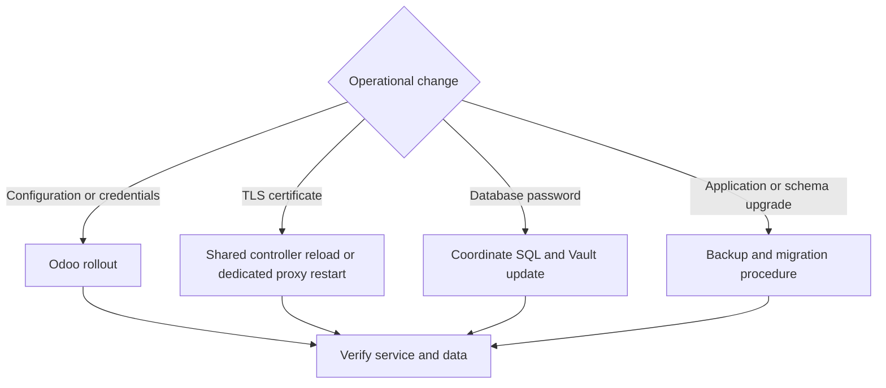

# Odoo on Kubernetes with Helm

One reusable Helm chart, three independent clients. Each client has its own Odoo,
PostgreSQL instance, namespace, two persistent volumes, Vault identity and resource
quota. Each client automatically scales its Odoo application from one to four
replicas using CPU metrics. The default application image is `odoo:20.0-20261102`. The client
configurations use an existing shared Traefik ingress controller.

Nothing has been applied to a cluster. [DESIGN.md](DESIGN.md) describes the architecture
and remaining production work; [docs/clients.md](docs/clients.md) explains configuration
and growth toward 100 clients.

**This project is starting with fresh installations. No volume or database migration
is needed.** Helm creates a new Longhorn RWX application volume and a separate RWO
PostgreSQL volume for each client. Migration guidance below applies only if you later
bring existing volumes or an older Odoo database into this deployment.

After installation, follow [the k3s verification runbook](docs/verification.md) to
check Metrics Server, automatic scale-up/down and shared storage on your cluster.

## Client inventory



| Client | Helm release | Namespace | Database / database role | Vault role | Vault KV location | Example hostname |
| --- | --- | --- | --- | --- | --- | --- |
| client-a | odoo | odoo-client-a | client_a | odoo-client-a | ODOO/CLIENT-A | client-a.odoo.example.com |
| client-b | odoo | odoo-client-b | client_b | odoo-client-b | ODOO/CLIENT-B | client-b.odoo.example.com |
| client-c | odoo | odoo-client-c | client_c | odoo-client-c | ODOO/CLIENT-C | client-c.odoo.example.com |

The release name `odoo` repeats in separate namespaces. Each release owns a separate
PostgreSQL StatefulSet and database volume; there is no shared database server.

## Files



```text
charts/odoo/
  Chart.yaml
  values.yaml                    # Common chart defaults
  templates/
    odoo/                        # Application, init container/config, HPA, Service, PVC, policy
    postgresql/                  # Dedicated database, initialization, PVC, network policy
    traefik/                     # Optional dedicated proxy and TLS secret sync
    ingress/                     # Routes through an existing shared controller
    vault/                       # VSO connection, identity and credentials sync
    common/
      validate.yaml              # Helm configuration checks; no Kubernetes resource
      resourcequota.yaml         # Optional namespace consumption limits
clients/
  common.values.yaml             # Vault, ingress, autoscaling, Longhorn RWX and quotas
  client-a/
    values.yaml                  # Database, hostname and Vault identity
    traefik.values.yaml          # Optional dedicated proxy for this client
  client-b/                      # Same two files with client B settings
  client-c/                      # Same two files with client C settings
docs/
  vault.md                       # Vault prerequisites, client bindings and rotation
  clients.md                     # Configuration, ingress prerequisites and scaling
  verification.md                # k3s checks, expected results and troubleshooting
```

## Prerequisites



- Helm and kubectl, with an explicitly selected Kubernetes context.
- Longhorn installed with StorageClass `longhorn` supporting ReadWriteMany (RWX).
  Install the required NFSv4 client packages on every eligible k3s node and verify
  shared volume permissions. PostgreSQL keeps its configured/default RWO storage.
- A working Metrics Server (`metrics.k8s.io` API); k3s usually includes one, but
  verify `kubectl top pods` works before relying on autoscaling. See the
  [k3s packaged components](https://docs.k3s.io/installation/packaged-components).
- A CNI enforcing NetworkPolicy. Check `clusterDomain` and `networkPolicy.dnsTo` against the cluster.
- VSO and its `secrets.hashicorp.com/v1beta1` CRDs, watching all client namespaces
  and authorized to synchronize Secrets and restart the client Odoo Deployments.
- Existing Vault Kubernetes-auth roles bound to `odoo-vault-auth` in each client's
  exact namespace. Create the separate policies and KV entries in
  [docs/vault.md](docs/vault.md#client-fleet-bindings). The chart does not create them.
- Vault TLS trust. If using a private CA, pre-create each namespace and its CA Secret
  with key `ca.crt`, then configure `vault.server.caCertSecret` before installing.
- An existing shared Traefik controller with IngressClass `traefik`, HTTPS entrypoint
  `websecure`, HTTP-to-HTTPS redirect and access to the client namespaces. Match
  `sharedIngress.controller.namespace` and `podLabels` to its actual deployment.
  See [the ingress prerequisites](docs/clients.md#shared-ingress-prerequisites).
- Real hostnames replacing `*.odoo.example.com`, DNS pointing to the shared controller,
  and matching certificates/private keys in each client's Vault entry.

Values are applied in this order: chart defaults → `clients/common.values.yaml` →
`clients/<client>/values.yaml` → that client's optional `traefik.values.yaml` → local
overrides. Add an ignored `-f cluster.local.yaml` after the client files on every
command when environment overrides are needed. Never put secrets in values.

Each client's `values.yaml` contains its Vault role and secret paths; shared Vault
connection settings live in `clients/common.values.yaml`. Database initialization
runs automatically in an init container, with no temporary values file.

## Validate locally



These commands require only Helm and do not contact Kubernetes. Substitute the
client name and namespace to check client-b or client-c.

```sh
helm lint --strict charts/odoo --namespace odoo-client-a \
  -f clients/common.values.yaml -f clients/client-a/values.yaml

helm template odoo charts/odoo --namespace odoo-client-a \
  -f clients/common.values.yaml -f clients/client-a/values.yaml
```

`templates/common/validate.yaml` rejects incompatible settings, including enabling
both proxy modes, an empty database name or enabling database listing. It emits
no Kubernetes resource. Rendering does not verify Vault, DNS or cluster behavior.

## Install a client with Helm



Run from the repository root after completing the prerequisites. These commands
change the cluster; they have not been executed here. Set `TARGET_CONTEXT` to the
intended kubeconfig context before running them.

Install each client independently:

```sh
helm install odoo charts/odoo \
  --kube-context "${TARGET_CONTEXT:?Set TARGET_CONTEXT first}" \
  --namespace odoo-client-a --create-namespace \
  -f clients/common.values.yaml \
  -f clients/client-a/values.yaml \
  --wait --timeout 15m

helm install odoo charts/odoo \
  --kube-context "${TARGET_CONTEXT:?Set TARGET_CONTEXT first}" \
  --namespace odoo-client-b --create-namespace \
  -f clients/common.values.yaml \
  -f clients/client-b/values.yaml \
  --wait --timeout 15m

helm install odoo charts/odoo \
  --kube-context "${TARGET_CONTEXT:?Set TARGET_CONTEXT first}" \
  --namespace odoo-client-c --create-namespace \
  -f clients/common.values.yaml \
  -f clients/client-c/values.yaml \
  --wait --timeout 15m
```

On an empty PostgreSQL volume, PostgreSQL creates the client's database and a
restricted owner role with `NOCREATEDB`. The Odoo pod then prepares its private
configuration and runs `initialize-database` using the same Odoo image and filestore.
The init container waits for its database, installs `base` and `web` without demo
data, and sets the initial administrator login/password from Vault keys
`odoo-admin-login` and `odoo-admin-password`. The main Odoo container starts only
after initialization completes. Database listing stays disabled throughout.

An already initialized database from the same Odoo major series is left unchanged. A database-local completion
marker prevents initial passwords from being reapplied on restart. If initialization
finishes but credential setup is interrupted, the next attempt finalizes credentials
before Odoo can start. Partial module installation blocks startup for manual recovery;
the init container never drops a database or automatically runs module upgrades.

VSO must synchronize all required credentials before the pod can initialize. If
installation times out, inspect the affected namespace without printing Secret data:

```sh
kubectl --context "${TARGET_CONTEXT:?Set TARGET_CONTEXT first}" \
  --namespace odoo-client-a get vaultstaticsecret
kubectl --context "${TARGET_CONTEXT:?Set TARGET_CONTEXT first}" \
  --namespace odoo-client-a logs deployment/odoo-odoo -c initialize-database
```

After readiness, verify HTTPS login using the initial web credentials, WebSockets,
and attachment upload/download. Readiness alone does not prove business workflows.
Changing the initial web credentials in Vault later does not reset an existing Odoo
login; manage subsequent password changes through Odoo.

For subsequent configuration changes, use normal values with `helm upgrade`:

```sh
helm upgrade odoo charts/odoo \
  --kube-context "${TARGET_CONTEXT:?Set TARGET_CONTEXT first}" \
  --namespace odoo-client-a --reset-values \
  -f clients/common.values.yaml \
  -f clients/client-a/values.yaml \
  --wait --timeout 15m
```

Substitute the client namespace and values file for client-b or client-c. Repeat
all environment-specific overrides. Database/module migrations require a separate
backup and maintenance procedure; the init container does not perform them.

### Only when importing an existing installation



Skip this section for the three fresh client installations. Their databases and
volumes are created automatically by Helm and the init containers.

For an existing **Odoo 19 database**, first back up the database and matching
filestore, migrate them using an appropriate Odoo major-version upgrade process,
and validate the migrated copy and all required addons with Odoo 20. The initializer
checks the installed base module version and blocks an unmigrated Odoo 19 database;
changing the image tag or running `helm upgrade` does not migrate it. See the
[Odoo upgrade documentation](https://www.odoo.com/documentation/20.0/administration/upgrade.html).
The install commands above are for new Odoo 20 installations.

For existing PostgreSQL volumes, initialization SQL does not run again. Confirm the
configured database and owner already exist, revoke any legacy `CREATEDB` privilege
through the database administrator, and add the two initial web credential keys to
Vault before upgrading. Existing initialized databases keep their current logins.
An existing incomplete database needs manual recovery. Different release, namespace,
database or PVC names require an explicit migration; this does not adopt a previous
`challenge` release.

## Automatic scaling per client



The common client values enable an `autoscaling/v2` HorizontalPodAutoscaler (HPA)
for each client's Odoo Deployment. It keeps at least one replica and scales up to
four when average CPU utilization exceeds 70% of the CPU request. With the default
500m request, the target is approximately 350m per pod. Scale-up is limited to one
additional pod per minute; scale-down has a five-minute stabilization window and
removes at most one pod per minute. Actual decisions depend on metrics and readiness.

Change a specific client's limits by adding `autoscaling` under its existing
`odoo` block in `clients/<client>/values.yaml`, retaining its database settings:

```yaml
odoo:
  database: client_a
  databaseUser: client_a
  autoscaling:
    minReplicas: 1
    maxReplicas: 3
    targetCPUUtilizationPercentage: 70
```

Apply the normal Helm upgrade command above. Scaling is automatic after deployment;
do not use `kubectl scale` to manage replica counts while HPA is enabled. The
Deployment omits `spec.replicas` so Helm upgrades do not reset the HPA's current count.
`odoo.replicas` is only used when `odoo.autoscaling.enabled: false`.

```sh
kubectl --context "${TARGET_CONTEXT:?Set TARGET_CONTEXT first}" \
  --namespace odoo-client-a get hpa odoo-odoo
kubectl --context "${TARGET_CONTEXT:?Set TARGET_CONTEXT first}" \
  --namespace odoo-client-a top pods -l app=odoo
```

All replicas mount the same client-specific Longhorn RWX volume at `/var/lib/odoo`,
sharing sessions and attachments. New replicas wait for the database initialization
lock and then skip completed initialization. Standard Odoo cron workers coordinate
jobs through PostgreSQL row locks; custom jobs must handle retries and external side
effects appropriately. The chart checks the maximum replica/worker connection budget
against PostgreSQL's connection limit, and client quotas allow the default four replicas.
CPU autoscaling does not detect every database or storage bottleneck; measure latency,
connections, CPU and Longhorn I/O before increasing capacity limits.

For a fresh installation, Helm creates the RWX application claim directly; leave
`odoo.storage.existingClaim` empty. Only an installation that already has an RWO
application PVC needs the [existing-volume migration procedure](docs/clients.md#only-for-existing-rwo-application-volumes).

Run the [post-installation checks](docs/verification.md) to confirm numerical CPU
metrics, actual automatic scale-up/down, RWX access and cross-replica sessions.
Those checks distinguish configuration that renders successfully from behavior
verified on k3s. No migration is part of the fresh-install verification.

This change provides automatic application scaling. PostgreSQL remains one instance,
updates still use `Recreate`, and storage/ingress failures can interrupt all replicas.
It does not establish end-to-end high availability.

## Internal services and secrets



For client-a, Odoo uses `odoo-db.odoo-client-a.svc.cluster.local:5432`. Its HTTP and
WebSocket ports are exposed through the internal Service `odoo-odoo` on 8069/8072.
The shared controller uses Kubernetes Service references to route `/` and `/websocket`.
Neither Odoo nor PostgreSQL creates a public load balancer.

NetworkPolicies allow the configured ingress controller → Odoo → that client's
PostgreSQL, plus DNS. Ingress-controller access matches both its namespace and pod
labels; database access remains within the client namespace. Administrative port-forwarding is a separate control-plane path.

VSO creates these namespace-local Secrets from each client's KV entry:

| Vault fields | Destination Secret | Consumer |
| --- | --- | --- |
| `admin-password`, `db-password`, `postgres-password` | `odoo-credentials` | Odoo/PostgreSQL, with only the required keys mounted per workload |
| `odoo-admin-login`, `odoo-admin-password` | `odoo-credentials` | Database init container only; initial Odoo web administrator |
| `tls.crt`, `tls.key` | `odoo-tls` | Shared ingress controller, or dedicated proxy |

The TLS sync exists only when a proxy mode is enabled. Vault remains existing
infrastructure in `vault-namespace`; its endpoint, auth mount, audience and CA trust
must match the environment. See [the Vault runbook](docs/vault.md).

## Optional dedicated proxy



The standalone chart also supports `traefik.enabled: true` instead of shared ingress.
To use it with client values, explicitly set `sharedIngress.enabled: false`, configure
`traefik.host` and `traefik.service.type`, and keep Odoo proxy mode enabled. The
dedicated proxy uses internal FQDN upstreams and provides its own HTTPS redirect.
It needs no IngressClass or shared controller. Both proxy modes cannot be enabled
together; obsolete `ingress.*` settings are rejected.

Each client has its own `traefik.values.yaml` for this mode. Include, for example,
`-f clients/client-a/traefik.values.yaml` after its normal values in both install
and upgrade commands. Apply local overrides after that file. Replace the dedicated proxy hostname before use
and point DNS to its Service. The three clients use shared ingress by default.

## Day-two behavior



- Odoo configuration changes and VSO credential changes restart Odoo.
- Shared ingress watches the client's TLS Secret. Dedicated Traefik instead restarts
  when VSO updates its certificate. Certificate issuance and renewal are external.
- PostgreSQL initialization runs only on an empty data directory. Secret updates do
  not change existing SQL passwords; coordinate database and Vault rotation.
- Both PVCs are retained on Helm uninstall, but not protected from namespace deletion.
  Retention is not a backup. Database and filestore must be recovered together.
- Odoo scales automatically but still uses `Recreate`; application rollouts interrupt
  service. PostgreSQL remains a single replica. Helm rollback cannot reverse database/module migrations.
- SMTP and external integrations are blocked by default and need deliberate egress rules.
- With `vault.enabled: false`, supply Secrets separately and restart Odoo after credential
  changes. For dedicated Traefik, use `traefik.tlsRevision` to trigger a certificate reload.

Adding another client means adding its values file, provisioning its Vault identity
and secrets, then repeating the Helm install and upgrade steps with a new namespace.
Backups, monitoring, automated onboarding and GitOps remain future work, as described
in [DESIGN.md](DESIGN.md#three-clients-with-a-path-to-100).
