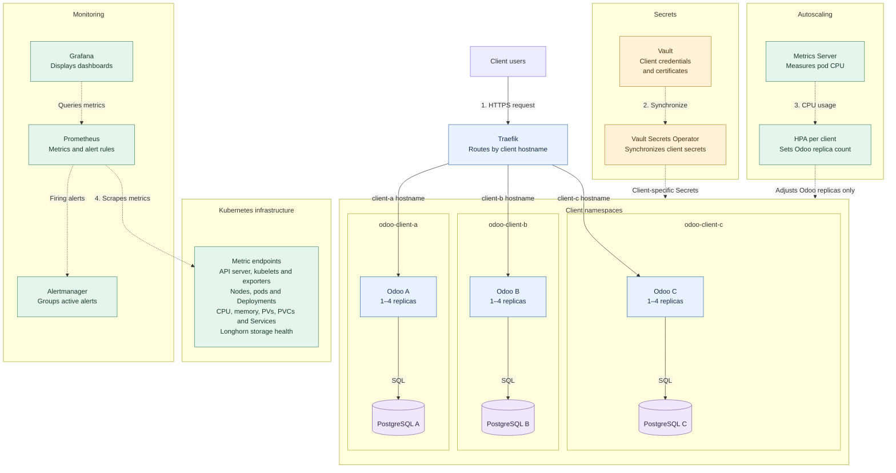

# Odoo on Kubernetes

A Helm deployment for three clients on k3s. Each client has its own namespace,
Odoo application, PostgreSQL instance, storage and Vault credentials.
Odoo 20 scales automatically from **1 to 4 replicas** using CPU metrics.



Solid arrows show application traffic. Dashed arrows show
secret synchronization, scaling decisions and monitoring interactions. Their labels
identify the action and direction. Everything except client users runs inside k3s; the boxes separate responsibilities, not cluster nodes.

| Flow | How to read it |
| --- | --- |
| 1. Client traffic | Traefik selects the client's Odoo by hostname. Odoo connects only to that client's PostgreSQL. |
| 2. Secrets | VSO reads the client's permitted Vault path and creates Secrets in that client's namespace. |
| 3. Scaling | Metrics Server supplies CPU usage. Each HPA adjusts its Odoo replicas between 1 and 4; PostgreSQL stays at one replica. |
| 4. Monitoring | Prometheus scrapes cluster-wide resource usage, workload state, PV/PVC and Service metadata, and Longhorn health. Grafana queries Prometheus; Alertmanager groups alerts. External notifications need configuration. |

Each client uses separate Longhorn volumes for Odoo and PostgreSQL. Vault,
Prometheus, Grafana and Alertmanager have their own Longhorn RWO volumes.
VSO is installed separately. Monitoring pod resources does not yet expose Vault
seal status or PostgreSQL internal health.

## Project structure

| Location | Purpose |
| --- | --- |
| `charts/odoo/` | Reusable Odoo/PostgreSQL chart |
| [services/vault/](services/vault/) | Shared TLS-enabled Vault StatefulSet and Services |
| [services/prometheus/](docs/prometheus.md) | Metrics collection, storage and alerts |
| [services/grafana/](docs/grafana.md) | Kubernetes overview dashboard |
| `clients/common.values.yaml` | Shared ingress, autoscaling, Longhorn and quota settings |
| `clients/client-{a,b,c}/values.yaml` | Client database, hostname and Vault identity |
| `clients/client-{a,b,c}/traefik.values.yaml` | Optional dedicated proxy |
| [DESIGN.md](DESIGN.md) | Architecture, decisions and limitations |
| [Client configuration](docs/clients.md) | Scaling and adding clients |
| [Vault setup](docs/vault.md) | Required secrets and access policies |
| [Verification](docs/verification.md) | Deployment and scaling checks |

## Prerequisites

- k3s, Helm and kubectl with the intended context selected.
- Longhorn StorageClass `longhorn` with RWX support and NFSv4 clients on eligible nodes.
- A working Metrics Server: `kubectl top pods` must return CPU/memory values.
- Traefik with IngressClass `traefik`, HTTPS and HTTP-to-HTTPS redirection.
- Vault and Vault Secrets Operator (VSO), configured as described in [Vault setup](docs/vault.md).
- Real client hostnames, DNS records and matching TLS certificates in Vault.
- NetworkPolicy enforcement, working cluster DNS and storage permissions for UID/GID 1000.

Match `sharedIngress.controller.namespace` and `podLabels` to the actual controller.
The common values assume namespace `traefik`; k3s-packaged Traefik normally runs in
`kube-system`. Both client volumes use Longhorn: RWX for Odoo, a separate RWO volume
for PostgreSQL.

Install [Prometheus](docs/prometheus.md) and
[Grafana](docs/grafana.md) to view nodes,
pods, workload health, PVC usage and alerts across all clients. The guides include
plain-manifest installation, Grafana login and verification of metric collection.

## Install a client with Helm

Run from the repository root. Set the context and replace example hostnames before
installation. Populate each client's Vault entry first. These are fresh installations;
Helm creates the volumes and the init container initializes Odoo automatically.

```sh
export TARGET_CONTEXT='your-k3s-context'

helm install odoo charts/odoo \
  --kube-context "${TARGET_CONTEXT:?Set TARGET_CONTEXT first}" \
  --namespace odoo-client-a --create-namespace \
  -f clients/common.values.yaml -f clients/client-a/values.yaml \
  --wait --timeout 15m

helm install odoo charts/odoo \
  --kube-context "$TARGET_CONTEXT" \
  --namespace odoo-client-b --create-namespace \
  -f clients/common.values.yaml -f clients/client-b/values.yaml \
  --wait --timeout 15m

helm install odoo charts/odoo \
  --kube-context "$TARGET_CONTEXT" \
  --namespace odoo-client-c --create-namespace \
  -f clients/common.values.yaml -f clients/client-c/values.yaml \
  --wait --timeout 15m
```

If environment overrides are needed, add an ignored `-f cluster.local.yaml` after
client values on every install/upgrade. Keep passwords and private keys in Vault.
The release name `odoo` is reused because each client has a separate namespace.

## Validate and update

Check the client configuration locally before installation or changes:

```sh
helm lint --strict charts/odoo \
  -f clients/common.values.yaml -f clients/client-a/values.yaml
helm template odoo charts/odoo --namespace odoo-client-a \
  -f clients/common.values.yaml -f clients/client-a/values.yaml
```

Apply configuration changes with the same values files:

```sh
helm upgrade odoo charts/odoo \
  --kube-context "${TARGET_CONTEXT:?Set TARGET_CONTEXT first}" \
  --namespace odoo-client-a --reset-values \
  -f clients/common.values.yaml -f clients/client-a/values.yaml \
  --wait --timeout 15m
```

Substitute the namespace and client file for B or C. Repeat local overrides.
Application rollouts use `Recreate` and interrupt service. Major Odoo upgrades need
an explicit database migration; Helm rollback cannot undo schema changes.

## Verify the deployment

Follow [the verification guide](docs/verification.md) to check login, attachments,
WebSockets, shared storage and automatic scale-up/down. Initial web login credentials
come from `odoo-admin-login` and `odoo-admin-password` in the client's Vault entry.

The application and two-replica shared-data behavior have been verified locally.
Actual HPA behavior, Longhorn RWX, Vault synchronization and ingress still require
verification on k3s. This case demonstrates **application scaling**, not full HA:
PostgreSQL remains a single instance. Backup automation and external alert
notifications remain future work; monitoring manifests are provided under `services/prometheus/` and `services/grafana/`.
