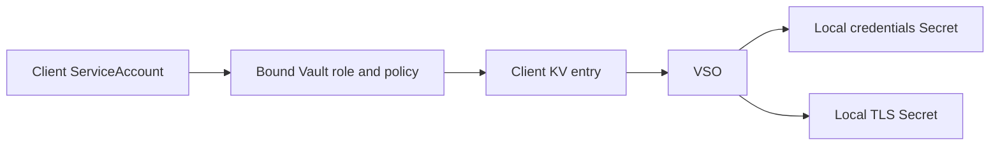

# Vault setup

Deploy the shared Vault servers using [services/vault](../services/vault/).
Vault Secrets Operator (VSO) is installed separately. The Odoo chart creates client
authentication and synchronization resources, not Vault policies or certificates.



## Connection and access

The common values use KV v2 mount `ODOO` and Vault address
`https://vault.vault-namespace.svc.cluster.local:8200`. Confirm that endpoint, auth
mount `kubernetes` and token audience `vault` against the actual installation.

Create these exact role bindings, each with read access only to its own path:

| Vault role | Kubernetes namespace | ServiceAccount | Policy path |
| --- | --- | --- | --- |
| odoo-client-a | odoo-client-a | odoo-vault-auth | ODOO/data/CLIENT-A |
| odoo-client-b | odoo-client-b | odoo-vault-auth | ODOO/data/CLIENT-B |
| odoo-client-c | odoo-client-c | odoo-vault-auth | ODOO/data/CLIENT-C |

Example policy for client-a:

```hcl
path "ODOO/data/CLIENT-A" {
  capabilities = ["read"]
}
```

Values use `kvMount: ODOO` and `credentialsPath: CLIENT-A`; `data/` belongs only in
the KV v2 policy path. Check that each identity is denied access to the other clients.
VSO must watch all client namespaces, request ServiceAccount tokens, manage Secrets
and restart the client Deployments. Its network access must allow Vault, DNS and the
Kubernetes API. Application pods do not connect to Vault.

For a private Vault CA, create a trust Secret with key `ca.crt` in each client namespace
and set `vault.server.caCertSecret` before installation. TLS verification stays enabled.
`vault.auth.namespace`, if used, is a Vault Enterprise namespace, not a Kubernetes namespace.

## Required KV fields

Populate each client's entry before Helm installation. Passwords must be distinct,
strong, single-line values without surrounding whitespace.

| Field | Purpose |
| --- | --- |
| `admin-password` | Odoo database-manager master password |
| `db-password` | Application PostgreSQL role password |
| `postgres-password` | PostgreSQL administrator password |
| `odoo-admin-login` | Initial Odoo web administrator login |
| `odoo-admin-password` | Initial Odoo web administrator password |
| `tls.crt`, `tls.key` | Matching certificate/full chain and key for the client hostname |

VSO selects the five credential fields into `odoo-credentials` and TLS fields into
`odoo-tls`, in the client's namespace. TLS synchronization exists only when a proxy
mode is enabled. The web-login fields are mounted only in the database init container;
the main application never receives the PostgreSQL administrator password.

Keep all fields populated on later upgrades. Initial web credentials apply only to
new setup; changing them in Vault does not reset an existing login. VSO will not
silently overwrite an unmanaged existing Secret. With `vault.enabled: false`, another
process must supply the Secrets and coordinate workload restarts.

## Synchronization and rotation

VSO polls every minute. Credential changes restart Odoo. For database password rotation,
stop writers during maintenance, update the SQL password, publish the matching Vault
value, wait for synchronization and resume Odoo. Changing a Secret or restarting
PostgreSQL alone does not change a stored SQL password.

Publish renewed TLS certificate/key pairs together. Shared ingress watches its TLS
Secret; dedicated Traefik restarts after synchronization. Certificate issuance and
renewal are external. Subsequent web-login password changes are managed through Odoo.

Inspect `VaultStaticSecret` status and events to diagnose synchronization, without
printing Secret contents. See [deployment verification](verification.md).
