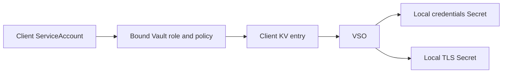

# Vault setup

Deploy the shared Vault servers using [services/vault](../services/vault/).
Vault Secrets Operator (VSO) is installed separately. The Odoo chart creates client
authentication and synchronization resources, not Vault policies or certificates.



## Start Vault and install VSO

Run commands from the repository root with the intended kube-context selected.
Vault needs three schedulable nodes, Longhorn and a server certificate whose SANs
cover `vault.vault-namespace.svc.cluster.local` and all three peer names:
`vault-0`, `vault-1` and `vault-2` under
`vault-internal.vault-namespace.svc.cluster.local`.

```sh
kubectl create namespace vault-namespace
kubectl -n vault-namespace create secret generic vault-tls \
  --from-file=tls.crt=/secure/path/tls.crt \
  --from-file=tls.key=/secure/path/tls.key \
  --from-file=ca.crt=/secure/path/ca.crt
kubectl apply -f services/vault/
kubectl -n vault-namespace get pods,pvc
```

The certificate file includes its chain. Keep its private key outside Git. Each
Vault instance has a separate 10 GiB Longhorn volume. Pods initially remain NotReady
until initialized and unsealed; the peer Service permits discovery during setup.

Initialize **only vault-0**, once, in a private terminal. Store the returned root
token and unseal shares securely outside the cluster with separate custodians.

```sh
kubectl -n vault-namespace exec -it vault-0 -- \
  vault operator init -key-shares=5 -key-threshold=3
kubectl -n vault-namespace exec -it vault-0 -- vault operator unseal
```

Repeat unseal with three distinct shares using the hidden prompt. After the peers
join automatically, unseal vault-1 and vault-2 using the same shares; never initialize
them separately. Manual unsealing is required after a server restarts. This deployment
does not configure auto-unseal. Replace/unseal servers one at a time during updates;
the StatefulSet uses `OnDelete`, so applying an update alone does not replace pods.

For a fresh Vault, open a shell, log in at the token prompt and configure its mounts:

```sh
kubectl -n vault-namespace exec -it vault-0 -- sh
vault login
vault audit enable file file_path=stdout
vault secrets enable -path=ODOO kv-v2
vault auth enable kubernetes
vault write auth/kubernetes/config kubernetes_host=https://kubernetes.default.svc:443
vault operator raft list-peers
```

The final command should show three voting instances and one leader. Vault uses its
local ServiceAccount token/CA for [Kubernetes authentication](https://developer.hashicorp.com/vault/api-docs/auth/kubernetes);
the supplied RBAC permits TokenReview. Collect audit logs durably. Configure normal
administrative access before revoking the initial root token; never use it for VSO.
Exit the shell before continuing with Kubernetes/Helm commands.

Install VSO and its CRDs separately using the
[official installation guide](https://developer.hashicorp.com/vault/docs/deploy/kubernetes/vso/installation).
VSO must be running before installing the Odoo chart's Vault resources. Vault server
manifests alone do not install the operator or configure client access.

## Connection and access

The common values use KV v2 mount `ODOO` and Vault address
`https://vault.vault-namespace.svc.cluster.local:8200`. The supplied server manifests
match this endpoint. The authentication mount is `kubernetes` and client tokens
use audience `vault`.

Create these exact role bindings, each with read access only to its own path:

| Vault role | Kubernetes namespace | ServiceAccount | Policy path |
| --- | --- | --- | --- |
| odoo-client-a | odoo-client-a | odoo-vault-auth | ODOO/data/CLIENT-A |
| odoo-client-b | odoo-client-b | odoo-vault-auth | ODOO/data/CLIENT-B |
| odoo-client-c | odoo-client-c | odoo-vault-auth | ODOO/data/CLIENT-C |

Inside an authenticated Vault shell, create the policy and role for client-a:

```sh
vault policy write odoo-client-a - <<'HCL'
path "ODOO/data/CLIENT-A" {
  capabilities = ["read"]
}
HCL
vault write auth/kubernetes/role/odoo-client-a \
  bound_service_account_names=odoo-vault-auth \
  bound_service_account_namespaces=odoo-client-a \
  audience=vault policies=odoo-client-a ttl=1h
```

Repeat for B and C using the exact names and paths in the table.

Values use `kvMount: ODOO` and `credentialsPath: CLIENT-A`; `data/` belongs only in
the KV v2 policy path. Check that each identity is denied access to the other clients.
VSO must watch all client namespaces, request ServiceAccount tokens, manage Secrets
and restart the client Deployments. Its network access must allow Vault, DNS and the
Kubernetes API. Application pods do not connect to Vault.

For a private Vault CA, create a trust Secret with key `ca.crt` in each client namespace
and set `vault.server.caCertSecret` before installation. Create the client namespace
first if needed; Helm can then reuse it. TLS verification stays enabled.
`vault.auth.namespace`, if used, is a Vault Enterprise namespace, not a Kubernetes namespace.

## Required KV fields

Populate each client's entry before Helm installation. Passwords must be distinct,
strong, single-line values without surrounding whitespace.

| Field | Purpose |
| --- | --- |
| `admin-password` | Odoo database-manager master password |
| `db-password` | Application PostgreSQL role password |
| `postgres-password` | PostgreSQL administrator password |
| `odoo-admin-login` | Initial Odoo web administrator login |
| `odoo-admin-password` | Initial Odoo web administrator password |
| `tls.crt`, `tls.key` | Matching certificate/full chain and key for the client hostname |

VSO selects the five credential fields into `odoo-credentials` and TLS fields into
`odoo-tls`, in the client's namespace. TLS synchronization exists only when a proxy
mode is enabled. The web-login fields are mounted only in the database init container;
the main application never receives the PostgreSQL administrator password.

Keep all fields populated on later upgrades. Initial web credentials apply only to
new setup; changing them in Vault does not reset an existing login. VSO will not
silently overwrite an unmanaged existing Secret. With `vault.enabled: false`, another
process must supply the Secrets and coordinate workload restarts.

## Synchronization and rotation

VSO polls every minute. Credential changes restart Odoo. For database password rotation,
stop writers during maintenance, update the SQL password, publish the matching Vault
value, wait for synchronization and resume Odoo. Changing a Secret or restarting
PostgreSQL alone does not change a stored SQL password.

Publish renewed TLS certificate/key pairs together. Shared ingress watches its TLS
Secret; dedicated Traefik restarts after synchronization. Certificate issuance and
renewal are external. Subsequent web-login password changes are managed through Odoo.

Inspect `VaultStaticSecret` status and events to diagnose synchronization, without
printing Secret contents. See [deployment verification](verification.md).
