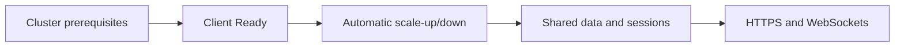

# Deployment verification

Run these checks after [installation](../README.md#install-a-client-with-helm), before
onboarding users. Repeat for all three clients. Local checks confirmed initialization,
login, attachments, WebSockets and shared data across two containers; k3s, Longhorn,
HPA, Vault and shared ingress still need validation on the target cluster.



## Cluster and client status

Replace the context placeholder and select the client namespace:

```sh
export TARGET_CONTEXT='your-k3s-context'
export TARGET_NAMESPACE='odoo-client-a'

kubectl --context "$TARGET_CONTEXT" get nodes
kubectl --context "$TARGET_CONTEXT" get storageclass longhorn
kubectl --context "$TARGET_CONTEXT" get apiservice v1beta1.metrics.k8s.io
kubectl --context "$TARGET_CONTEXT" top nodes
helm status odoo --kube-context "$TARGET_CONTEXT" --namespace "$TARGET_NAMESPACE"
kubectl --context "$TARGET_CONTEXT" -n "$TARGET_NAMESPACE" get pods -o wide
kubectl --context "$TARGET_CONTEXT" -n "$TARGET_NAMESPACE" get pvc
kubectl --context "$TARGET_CONTEXT" -n "$TARGET_NAMESPACE" get vaultstaticsecret
kubectl --context "$TARGET_CONTEXT" -n "$TARGET_NAMESPACE" get hpa odoo-odoo
```

Expected: nodes Ready, metrics API available, numerical CPU values, pods Ready,
VSO synchronized and claims Bound. `odoo-odoo-data` must be **RWX** on Longhorn;
`odoo-db-data` must be **RWO**. HPA should show the configured limits and numerical
CPU utilization, not persistent `<unknown>`. Allow time for initial metrics collection.
No volume migration is needed for these fresh installations.

## Automatic scaling

Watch the HPA and generate sustained CPU load in the verification environment:

```sh
kubectl --context "$TARGET_CONTEXT" -n "$TARGET_NAMESPACE" get hpa odoo-odoo --watch
```

For a controlled check, choose a Ready Odoo pod from the list above and run this in
another terminal with the same context/namespace variables. It creates CPU load for
five minutes without modifying application data; it competes with Odoo for CPU.

```sh
export POD_A='replace-with-a-ready-odoo-pod-name'
kubectl --context "$TARGET_CONTEXT" -n "$TARGET_NAMESPACE" \
  exec -i "$POD_A" -c odoo -- python3 - <<'PY'
from multiprocessing import Process
import time

def consume_cpu():
    deadline = time.monotonic() + 300
    while time.monotonic() < deadline:
        sum(number * number for number in range(10000))

workers = [Process(target=consume_cpu) for _ in range(2)]
for worker in workers:
    worker.start()
for worker in workers:
    worker.join()
PY
```

Pass: HPA automatically requests additional replicas and they become Ready. After
load ends, it reduces the count toward its minimum. Allow the five-minute scale-down
stabilization period and up to one removal per minute. The load need not reach exactly
four replicas. Do not use `kubectl scale` to demonstrate automatic behavior.

## Shared storage and sessions

While two replicas are Ready, select `POD_A` and `POD_B` from `get pods -o wide`.
Prefer different nodes; same-node checks do not establish cross-node RWX behavior.
Every eligible node needs NFSv4 client support and working Longhorn connectivity.

Create a scratch file exclusively on A, then read and remove it through B:

```sh
export POD_A='replace-with-first-ready-odoo-pod-name'
export POD_B='replace-with-second-ready-odoo-pod-name'
kubectl --context "$TARGET_CONTEXT" -n "$TARGET_NAMESPACE" exec "$POD_A" -c odoo -- \
  python3 -c 'from pathlib import Path; p=Path("/var/lib/odoo/.odoo-rwx-verification"); f=p.open("x"); f.write("rwx-ok"); f.close()'
kubectl --context "$TARGET_CONTEXT" -n "$TARGET_NAMESPACE" exec "$POD_B" -c odoo -- \
  python3 -c 'from pathlib import Path; p=Path("/var/lib/odoo/.odoo-rwx-verification"); assert p.read_text()=="rwx-ok"; p.unlink(); print("Shared storage verified")'
```

If the scratch file already exists, inspect the previous attempt before reusing it.
For sessions, run these port-forwards in separate terminals:

```sh
kubectl --context "$TARGET_CONTEXT" -n "$TARGET_NAMESPACE" port-forward "pod/$POD_A" 18069:8069
```

```sh
kubectl --context "$TARGET_CONTEXT" -n "$TARGET_NAMESPACE" port-forward "pod/$POD_B" 28069:8069
```

Log in at `http://localhost:18069`, then open `http://localhost:28069` in the same
browser profile. Pass: the second replica recognizes the session. Upload an attachment
through the deployed application's UI on one replica and download it through the
other. Stop the port-forwards afterward. These checks bypass ingress.

## Public access and troubleshooting

Through the real hostname, verify the trusted TLS certificate, HTTP-to-HTTPS redirect,
login and attachment access. Browser developer tools should show a `/websocket`
upgrade with status **101**. Confirm requests continue after HPA scales down;
WebSocket connections may reconnect.

| Problem | Inspect |
| --- | --- |
| HPA CPU is `<unknown>` | Metrics Server, readiness and CPU requests |
| Replicas requested but Pending | Node capacity, quota and PVC/mount events |
| RWX mount or permission errors | Longhorn health, NFS clients and UID/GID 1000 access |
| Initialization blocked | VSO status, database connectivity and init logs |
| Sessions/files differ between replicas | Same claim, data directory, image and permissions |

```sh
kubectl --context "$TARGET_CONTEXT" -n "$TARGET_NAMESPACE" describe hpa odoo-odoo
kubectl --context "$TARGET_CONTEXT" -n "$TARGET_NAMESPACE" get events --sort-by=.metadata.creationTimestamp
kubectl --context "$TARGET_CONTEXT" -n "$TARGET_NAMESPACE" logs deployment/odoo-odoo -c initialize-database
```

Record the client, observed replica changes, node placement and results. Do not delete
PVCs or expose credentials while diagnosing a failure. Scaling verification is not
proof of database/storage failover or full HA.
